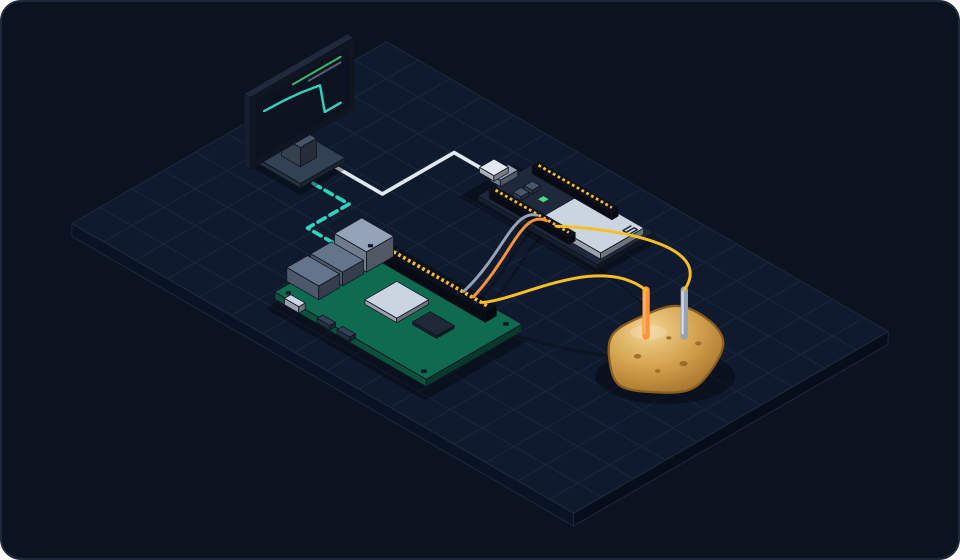

# Krumpir

X-in-the-loop test bench for embedded controllers.

| | |
|---|---|
| **Controllers** |   |
| **Plants** |  |
| **Runner** |  |
| **Tech** |          |

## What it is

Krumpir is a low-cost bench for testing an embedded controller against a simulated plant instead of
the real hardware. The plant runs as an FMI 3.0 co-simulation FMU, stepped by a real-time runner.
An I/O stage connects the runner to the device under test, which sees the simulated plant as if it were the real one.
The same controller code also runs against the same plant on the PC, so a test can climb from software-in-the-loop to
hardware-in-the-loop without changing the controller.

The repository contains:

- **Controllers**: the firmware under test ([controllers/](controllers/README.md)).
- **Shared libraries**: portable C for the controllers and the plant models, which are also packaged as FMUs ([libs/](libs/README.md)).
- **Runner**: the real-time FMU runner and its model-access service ([runner/](runner/README.md)).
- **Tools**: a Python client for scripting tests, controller code generation, serial capture and
  timing scripts, and schematic generation ([tools/](tools/)).
- **Docs**: ([docs/](docs/)).