# Controllers

The devices under test: each an ESP32 (ESP32-WROOM-32 DevKit) running a deterministic 1 kHz
control loop against a simulated plant. Building and flashing: [../BUILDING.md](../BUILDING.md#firmware)
(`python tools/kb.py fw|flash <ctrl> [hil|xcp]`).

| Controller | What it controls |
|---|---|
| [esp32-motor-controller](#motor-controller) | PID speed control of a DC motor |
| [esp32-t12-controller](#t12-controller) | temperature control of a T12 / T15 soldering tip |

**Contents:** [Shared design](#shared-design) · [Serial console](#serial-console) ·
[Motor controller](#motor-controller) · [T12 controller](#t12-controller) ·
[Schematics](#schematics) · [Board tools](#board-tools) · [Code generation](#code-generation) ·
[XCP](#xcp) · [Adding a controller](#adding-a-controller) ·
[HIL on the PC and the board](#hil-on-the-pc-and-the-board)

## Shared design

- The control logic is portable C with no ESP-IDF or FreeRTOS includes (`lib/` in each
  controller, building blocks in `libs/ctrlcore`, the plant in `libs/plants`). It is unit tested
  on the PC with Unity and runs unchanged on the target.
- An I/O abstraction runs the same controller against the simulated plant on the chip, the real
  hardware, or the runner over the HIL link (env `esp32dev-hil`, and the PC build in `host/`).
- The runtime around it (parameters with limits, run/stop/clear, trips, the calibration page) is
  `libs/rte`, generated from `controller.toml` ([Code generation](#code-generation)); the ESP-IDF
  glue (tick task, telemetry, console) is `libs/esp/espglue` ([../libs/README.md](../libs/README.md)).
- A task watchdog resets the board if the control loop hangs; safety trips are latched until
  `clear`.

Firmware envs: `esp32dev` (on-chip plant), `esp32dev-hil` (the plant behind the runner on UART2,
GPIO17 TX / GPIO16 RX, 921600 baud; each controller's `docs/krumpir-interface.md`),
`esp32dev-xcp` (XCP over Wi-Fi), `native` (the Unity tests on the PC).

## Serial console

`pio device monitor` (115200 baud). The firmware boots stopped, with the tuned gains; settings
are lost on reset. Common to both controllers:

| Command | Effect |
|---|---|
| `sp <value>` | setpoint |
| `kp` / `ki` / `kd <value>` | gains, finite and >= 0 |
| `start` / `stop` | run the controller / output 0 and PID reset |
| `clear` | clear a latched trip; `start` is refused until then |
| `status` | state, trip, measurements, loop timing since the last `status` |
| `log on` / `log off` | CSV telemetry |

## Motor controller

`esp32-motor-controller`: PID speed control of a DC motor, 1 kHz. Control logic in
`lib/motorctrl/` (`motor_loop`: the whole controller per tick, behind `motor_io_t`). CSV telemetry
at 100 Hz. Latched overspeed and sensor-timeout trips. Prompt `motor>`; besides the common
commands:

| Command | Effect |
|---|---|
| `sp <rpm>` | setpoint, within +-10000 |
| `load <Nm>` | simulation only: load torque on the shaft, within +-0.1 |
| `inertia <scale>` | simulation only: rotor inertia scale, 0.1 to 10 (1 = nominal) |
| `log on` | `t_ms,setpoint_rpm,speed_rpm,duty_permille` |

Example: `sp 3000`, `start`, then `status` shows the speed settling at 3000 rpm.

| Step to 3000 rpm on the board | in simulation |
|:---:|:---:|
| 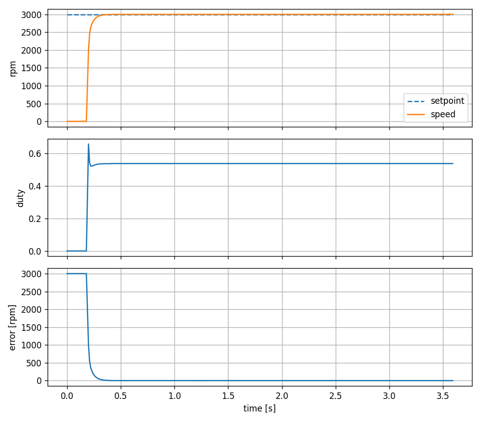 | 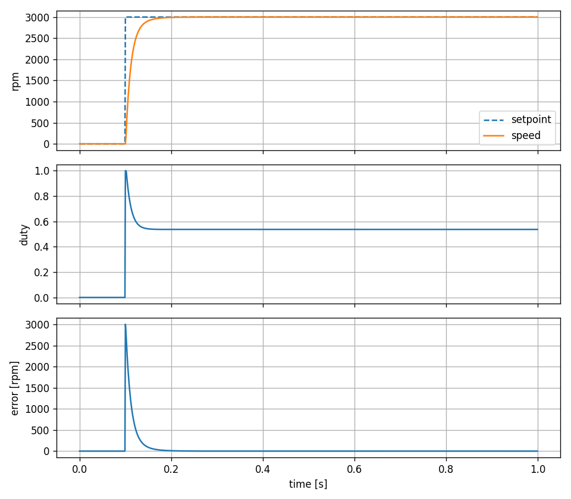 |

| Load step | Saturation | Inertia change |
|:---:|:---:|:---:|
| 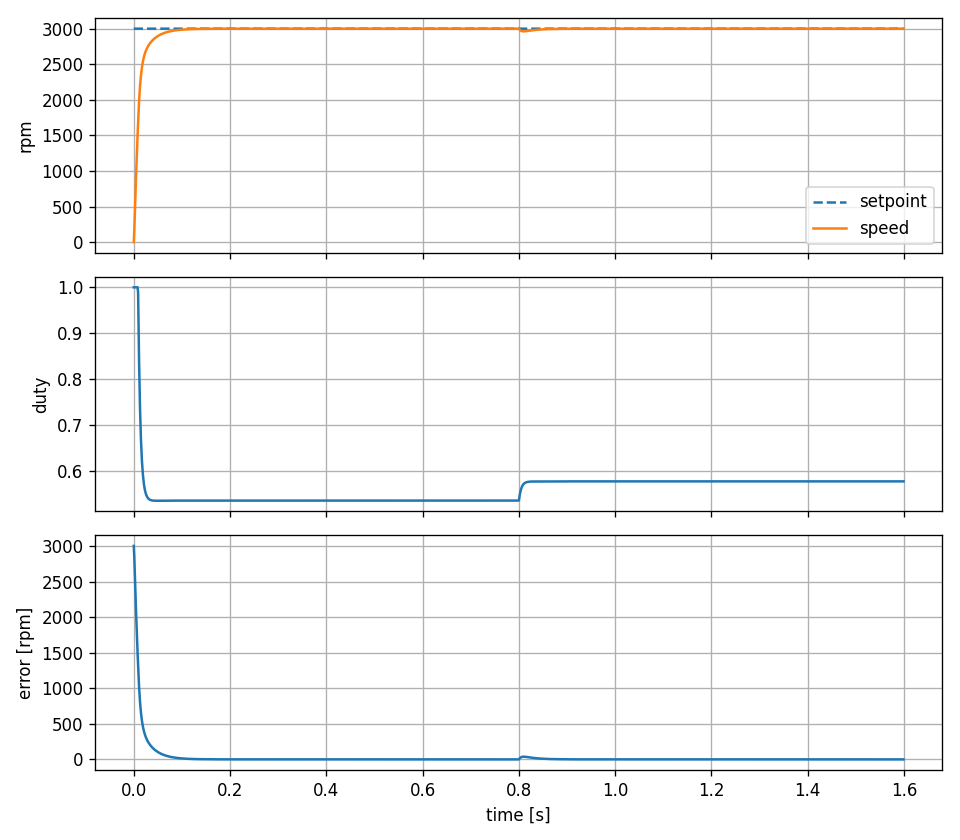 | 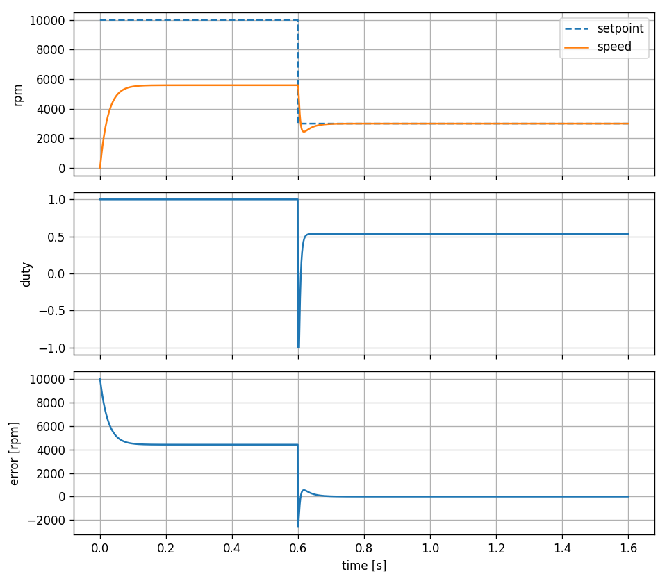 | 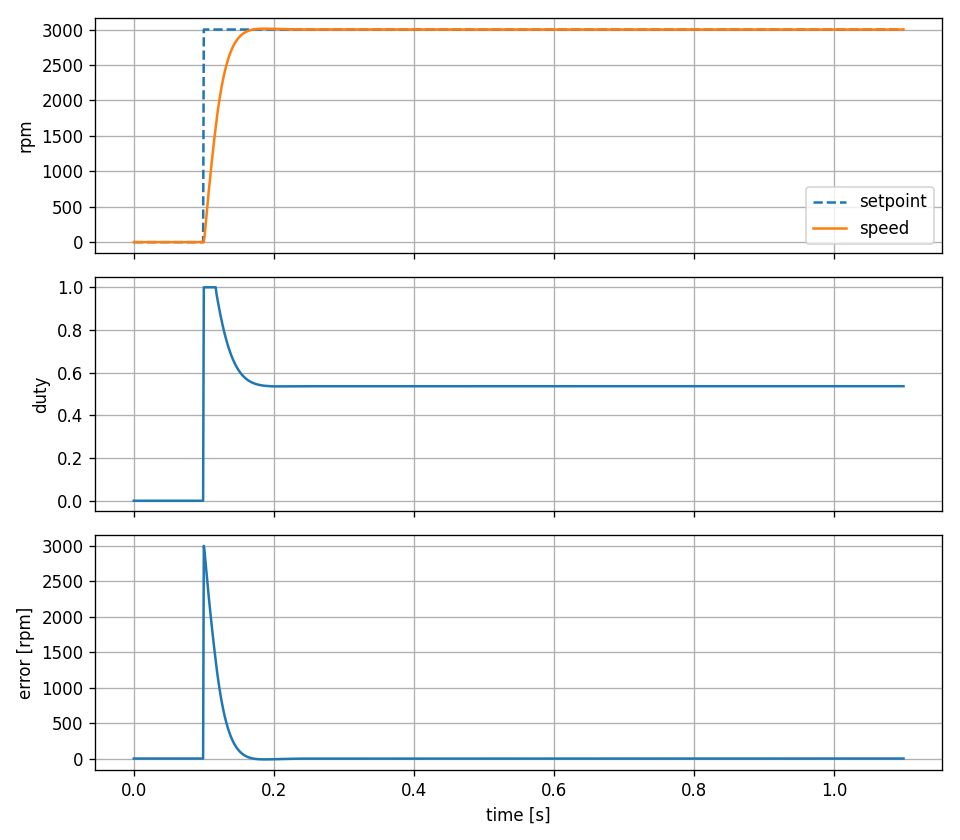 |

On the PC, from the controller folder (`tools/step_response.c`, `tools/scenarios.c`):

```sh
gcc -Ilib/motorctrl/include -I../../libs/ctrlcore/include -I../../libs/plants/dcmotor/include \
  tools/step_response.c lib/motorctrl/src/motor_io_sim.c lib/motorctrl/src/motor_ctrl.c \
  lib/motorctrl/src/motor_safety.c lib/motorctrl/src/motor_loop.c ../../libs/ctrlcore/src/pid.c \
  ../../libs/plants/dcmotor/src/plant_sim.c -lm -o .pio/step_response.exe
.pio/step_response.exe > docs/step_response.csv
python tools/plot.py docs/step_response.csv docs/step_response.png
.pio/scenarios.exe step|load|saturation|inertia > docs/scenario_x.csv   # build: docs/tuning.md
.pio/scenarios.exe sweep                                                  # gain sweep, markdown
```

Docs: [tuning](esp32-motor-controller/docs/tuning.md) (motor model, gains, scenarios, targets,
trips), [timing](esp32-motor-controller/docs/timing.md) (the measured loop),
[krumpir-interface](esp32-motor-controller/docs/krumpir-interface.md) (what a bench drives and
observes), [SIL vs PC](esp32-motor-controller/docs/sil_vs_pc.md).

**Hardware** (`hardware/`, KiCad 10): ESP32 DevKit, DRV8833 driver, a 6 V N20 gearmotor with a
quadrature hall encoder, and the header to the Pi. The firmware simulates the motor and drives
only GPIO 23 (loop timing) and the UARTs.

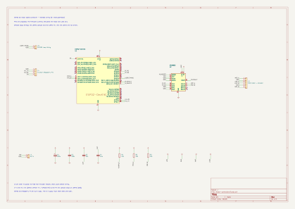

| ESP32 pin (DevKitC pad) | Net | Goes to |
|---|---|---|
| GPIO 18 (30) | `M_IN1` | DRV8833 AIN1 (PWM) |
| GPIO 19 (31) | `M_IN2` | DRV8833 AIN2 (PWM) |
| GPIO 27 (11) | `M_NSLEEP` | DRV8833 nSLEEP |
| GPIO 26 (10) | `M_NFAULT` | DRV8833 nFAULT, pulled up to 3V3 by R1 (10 k) |
| GPIO 34 (5) | `ENC_A` | encoder A (J2 pin 3), pulled up by R2 (10 k) |
| GPIO 35 (6) | `ENC_B` | encoder B (J2 pin 4), pulled up by R3 (10 k) |
| GPIO 23 (37) | `LOOP_TIMING` | test header J3 (loop-timing pulse) |
| GPIO 17, U2TXD (28) | `HIL_TX` | Krumpir header J4 pin 2 (HIL link, UART2) |
| GPIO 16, U2RXD (27) | `HIL_RX` | Krumpir header J4 pin 3 (HIL link, UART2) |
| EN, CHIP_PU (2) | `EN` | Krumpir header J4 pin 4 (reset) |

- Connectors: J1 6 V in (1 `+6V`, 2 `GND`); J2 motor + encoder (1 motor +, 2 `GND`, 3 `ENC_A`,
  4 `ENC_B`, 5 `+3V3`, 6 motor -: the common N20 order, check yours); J3 loop timing; J4 the Pi
  (1 `GND`, 2 `HIL_TX`, 3 `HIL_RX`, 4 `EN`).
- The pins avoid the strapping pins (0, 2, 5, 12, 15); GPIO 34/35 are input-only without pull-ups,
  hence R2/R3. DRV8833 bridge A drives the motor (C1 100 uF and C2 100 nF on `+6V`, C3 10 nF
  charge pump, C4 2.2 uF on `VINT`); bridge B and current sensing are unused (tied to GND).
- J4 is the HIL link (`esp32dev-hil`, UART2 at 921600): `HIL_TX` goes to the Pi's (or the
  USB-serial adapter's) receive pin. The console stays on UART0, the DevKit's USB. All 3.3 V
  logic; the 6 V supply shares GND with both.
- Not included: PCB layout, current sensing, reverse-polarity protection, an emergency stop.

## T12 controller

`esp32-t12-controller`: temperature control of a T12 / T15 soldering tip, 1 kHz loop with a
100 ms heater cycle (heat, wait for the switching artifact to settle, average the thermocouple
while the heater is off, update the PID). Control logic in `lib/t12ctrl/` behind `t12_io_t`
(heater, thermocouple, handle NTC, heater current, heartbeat; raw ADC counts). CSV telemetry at
10 Hz. Latched trips for over temperature, a stuck heater switch, a short, a missing tip, a wrong
heater resistance, invalid readings and thermal runaway; a trip also stops the heartbeat that
keeps the series switch on. Prompt `t12>`, boots with setpoint 350 C; besides the common
commands:

| Command | Effect |
|---|---|
| `sp <degC>` | setpoint, 100 to 450 |
| `ramp <K/s>` | setpoint ramp rate, 0 = off |
| `load <W/K>` | simulation only: heat drawn by touching a joint, 0 to 1 |
| `ambient <degC>` | simulation only: room temperature, -20 to 60 |
| `fault none/open/short/stuck` | simulation only: inject a tip fault |
| `log on` | `t_ms,setpoint_c,temp_c,duty_permille,current_ma` |

Example: `sp 350`, `start`; the board reaches 350 C about 5.7 s after heating starts (6.0 s in
the simulation), then holds 350 to 351 C at a duty of about 0.16 and 3.00 A.

| Cold start on the board | in simulation |
|:---:|:---:|
| 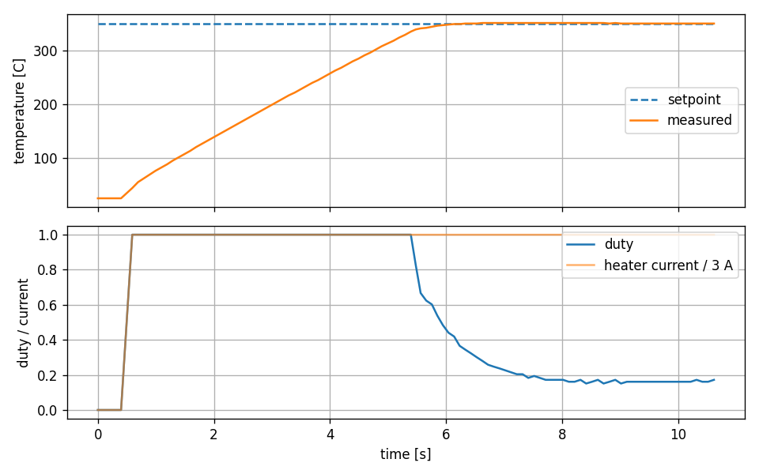 | 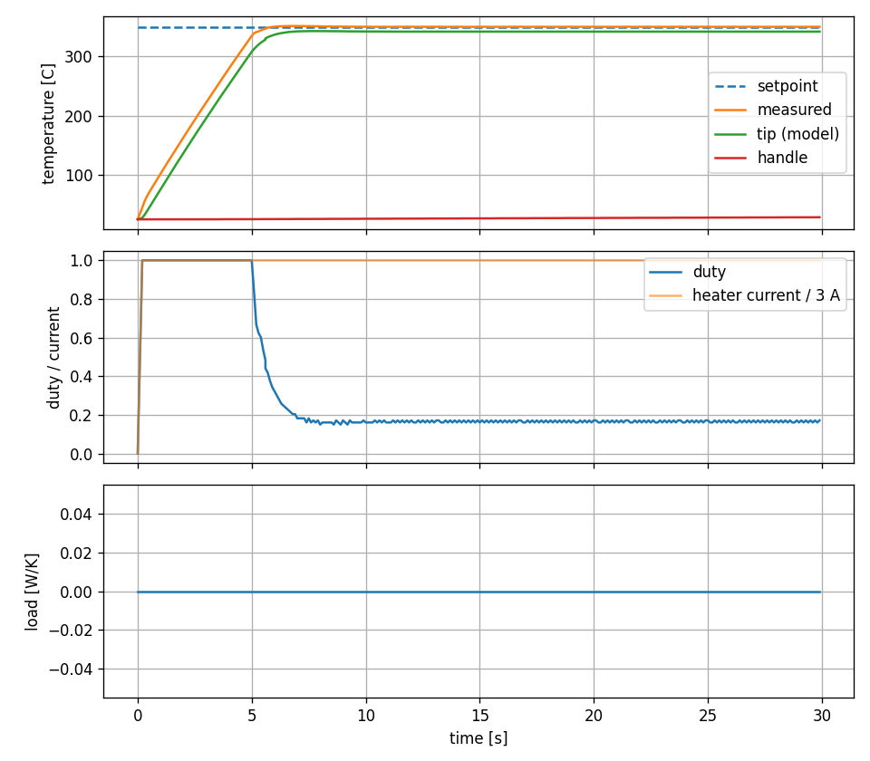 |

| Joint load | Missing tip | Thermal runaway |
|:---:|:---:|:---:|
| 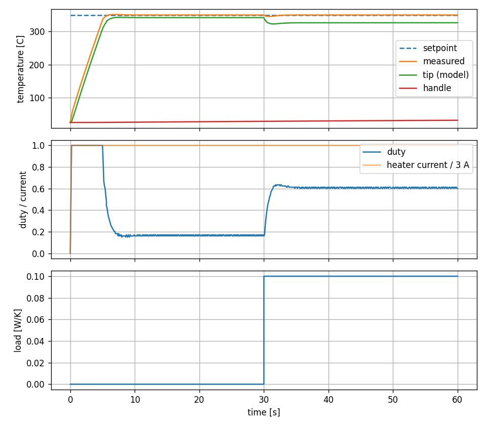 | 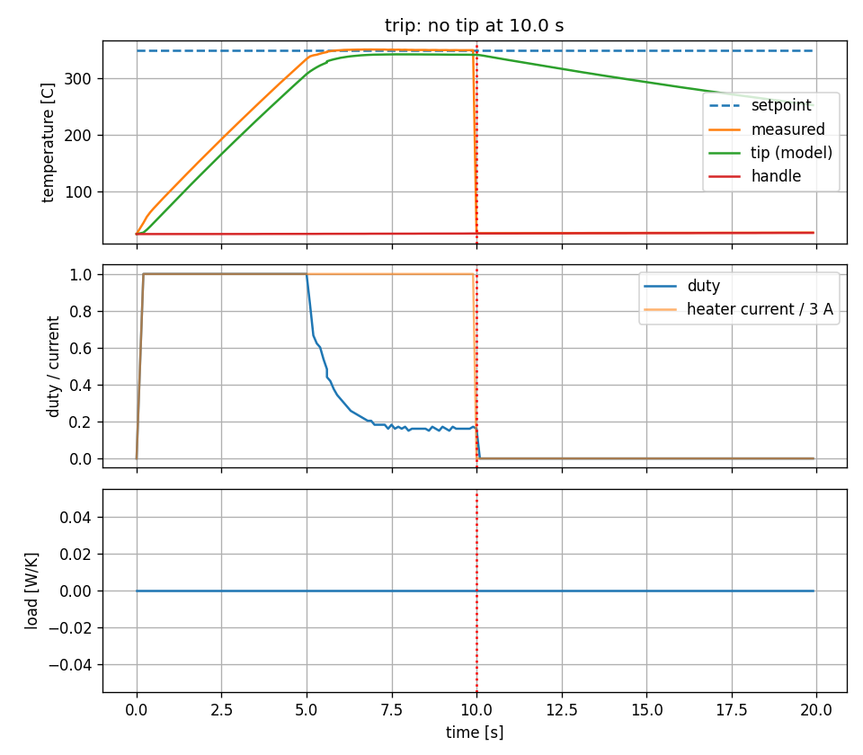 | 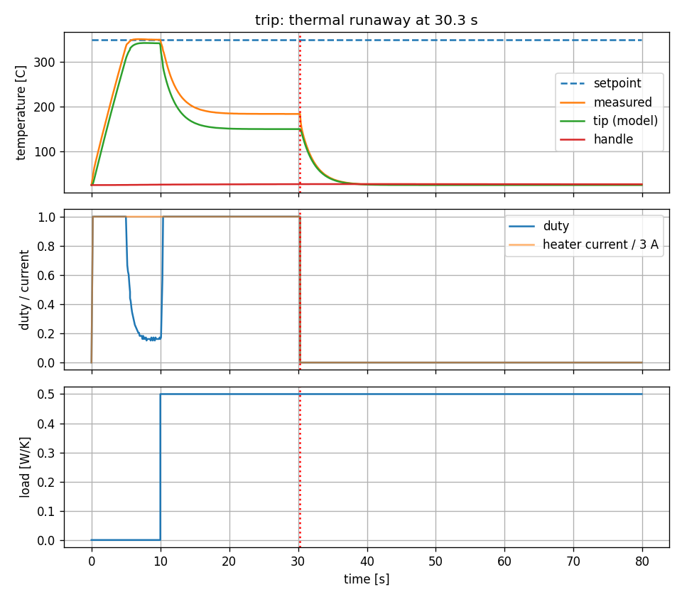 |

On the PC, from the controller folder:

```sh
gcc -Ilib/t12ctrl/include -I../../libs/ctrlcore/include -I../../libs/plants/t12/include \
  tools/scenarios.c lib/t12ctrl/src/t12_scenario.c lib/t12ctrl/src/t12_loop.c \
  lib/t12ctrl/src/t12_ctrl.c lib/t12ctrl/src/t12_cycle.c lib/t12ctrl/src/t12_convert.c \
  lib/t12ctrl/src/t12_safety.c lib/t12ctrl/src/t12_io_sim.c ../../libs/ctrlcore/src/pid.c \
  ../../libs/ctrlcore/src/step_metrics.c ../../libs/plants/t12/src/t12_plant.c -lm -o .pio/scenarios.exe
.pio/scenarios.exe cold > docs/scenario_cold.csv     # or load|ambient|open|short|stuck|runaway
.pio/scenarios.exe summary                           # every scenario's results, markdown
.pio/scenarios.exe sweep                             # kp / ki sweep
python tools/plot.py docs/scenario_cold.csv docs/scenario_cold.png
```

Docs: [tuning](esp32-t12-controller/docs/tuning.md) (tip model, gains, scenarios, targets,
trips), [krumpir-interface](esp32-t12-controller/docs/krumpir-interface.md),
[SIL vs PC](esp32-t12-controller/docs/sil_vs_pc.md).

**Hardware** (`hardware/`, KiCad 10): a 24 V heater switched on the high side by two P-MOSFETs in
series, high-side current sensing, a thermocouple amplifier and a 3.3 V buck converter that powers
the DevKit. An untested reference design without PCB layout: prototype it on a current-limited
bench supply. The firmware simulates the tip and drives only GPIO 23 and the UARTs.

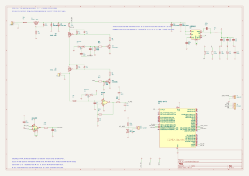

| Block | Parts |
|---|---|
| Power input | J1, F1 5 A fuse, Q4 reverse-polarity P-MOSFET (D5 12 V zener, R9), D2 SMBJ28A TVS, C2 470 uF |
| Series switch | R1 10 mohm shunt, Q3 P-MOSFET (R7, D7, R8), Q5 driver |
| Heartbeat detector | C5, D4 BAT54S, C6, R13, R12: GPIO 26 toggling holds Q5, and so Q3, on |
| Heater switch | Q1 P-MOSFET (R5, D6, R6), Q6 driver (R10, R11), J2 tip connector |
| Thermocouple | R4 10k and D1 BAT54S protection, C1, U3 OPA333 with R2 249k / R3 1k (gain 250), R14 / C3 filter |
| Heater current | U4 INA240A2 across R1 (50 V/V, 3 A gives 1.5 V), R15 / C4 filter |
| Handle NTC | R16 100k, TH1 NTC 100k, J3 for an NTC in the handle |
| Buck converter | U2 LMR36510 (4.2 to 65 V in, 3.3 V out), C11 / C12, L1 22 uH, C15 to C17, R17 / R18, D3 3.6 V clamp |
| ESP32 | U1 DevKitC, C9 / C10, J4 loop timing, J5 Krumpir header |

| ESP32 pin (DevKitC pad) | Net | Goes to |
|---|---|---|
| GPIO 25 (9) | `PWM` | R10 and Q6, which switch heater switch Q1 |
| GPIO 26 (10) | `HEARTBEAT` | C5, the heartbeat detector that holds Q3 on |
| GPIO 34 (5) | `TC_ADC` | thermocouple amplifier output (R14 / C3) |
| GPIO 35 (6) | `NTC_NODE` | handle NTC divider |
| GPIO 36 (3) | `CUR_ADC` | INA240 output (R15 / C4) |
| GPIO 23 (37) | `LOOP_TIMING` | test header J4 |
| GPIO 17, U2TXD (28) | `HIL_TX` | Krumpir header J5 pin 2 (HIL link, UART2) |
| GPIO 16, U2RXD (27) | `HIL_RX` | Krumpir header J5 pin 3 (HIL link, UART2) |
| EN, CHIP_PU (2) | `EN` | Krumpir header J5 pin 4 (reset) |

- Connectors: J1 24 V in (1 `GND`, 2 `+24V_IN`), J2 tip (1 shell `GND`, 2 `TIP_PLUS`), J3 handle
  NTC, J4 loop timing, J5 the Pi: the HIL link on UART2 (1 `GND`, 2 `HIL_TX`, 3 `HIL_RX`,
  4 `EN`). J1/J2 are drawn rotated: pin 2 is the live pin.
- Only ADC1 (GPIO 34, 35, 36), since ADC2 is unusable while Wi-Fi runs. The buck converter feeds
  the DevKit's 3V3: do not power it from USB and 24 V at once. The tip shell is ground, so the
  heater is switched high-side; everything on `+24V_SW` must be rated 60 V or more (the TVS can
  clamp at 45 V).
- **Check before building:** the buck values follow the LMR36510 datasheet's 3.3 V example; the
  values the design does not give (22k base of Q5, 4.7k of Q6, the 100k / 100k NTC divider with
  beta 3950, the 100 ohm / 10 nF filters) need confirming on the prototype; route the INA240 as a
  Kelvin connection at R1; pick P-MOSFETs with VDS -60 V, RDS(on) under 30 mohm at -10 V, ID 10 A
  or more, and check their pin order; one star ground at C2's negative terminal, with the heater
  return, the buck and the analog ground run to it separately.
- Not included: PCB layout, thermal design of the switches, an emergency stop, a mains supply.

## Schematics

Both schematics are generated: `hardware/generate_schematic.py` holds the part and net tables and
writes the files through `tools/kicad/kicadgen.py` (its docstring has the format). Change the
tables and rerun; do not regenerate over a schematic edited in KiCad. The generator writes
`<name>.kicad_pro` only when it does not exist, so KiCad's project settings stay.

```sh
python generate_schematic.py --check     # writes the files, prints each net and its pins
python generate_schematic.py --out DIR   # into DIR instead, for comparing
kicad-cli sch erc --severity-all --format report -o erc.rpt <name>.kicad_sch
kicad-cli sch export pdf -o <name>.pdf <name>.kicad_sch
kicad-cli sch export svg -o . <name>.kicad_sch
```

Needs KiCad 10 (`kicad-cli` in `C:\Program Files\KiCad\10.0\bin`) with the
[Espressif KiCad libraries](https://github.com/espressif/kicad-libraries) (symbol and footprint
`ESP32-DevKitC`, installed from the Plugin and Content Manager; check your board's pin layout
against it). The script reads KiCad's stock symbols from the default Windows install
(`KICAD_SYMBOL_DIR` otherwise) and the Espressif one from `~\Documents\KiCad\10.0\3rdparty`
(`KICAD_3RD_PARTY_DIR`). ERC: the T12 has no violations; the motor two expected warnings (AISEN and
BISEN tied to the power-flagged `GND`, as the datasheet specifies for unused current sensing).

## Board tools

`tools/serial` in the repository, for any controller on `libs/esp/espglue`; close the serial
monitor first (the port opens once). Needs pyserial (the venv). From the repository root:

```sh
python tools/serial/capture.py --port COM4 --duration 10 --cmd "sp 350" "start" -o capture.csv
python tools/serial/timing_check.py --port COM4 --setup "sp 350" "start" --teardown "stop" \
    --rate-hz 10 --max-exec-us 200          # T12; motor: --setup "sp 3000" "start"
python tools/serial/timing_check.py --port COM4 --project controllers/esp32-t12-controller --flash
python tools/serial/timing_check.py --selftest
```

- `capture.py` sends `log on`, runs each `--cmd`, records for `--duration` s: the columns of the
  firmware's header, time from zero in seconds, `_permille` divided by 1000, `_ma` as amps. Each
  controller's `tools/plot.py` draws a capture the same way as a scenario.
- `timing_check.py` reads the loop statistics from `status`: PASS with 0 overruns, the period
  within +-50 us of 1 ms (`--max-jitter-us`), the execution time under `--max-exec-us` (100 us;
  the T12 uses 200 us since it simulates the tip in double precision, measured about 23 us mean,
  100 us worst) plus `--busy-us`, at least 90 % of the cycles. `--log` streams telemetry meanwhile
  and also wants 0 dropped samples and 90 % of the rows (`--rate-hz`). Exit 0 pass, 1 out of
  limits, 2 no board. The motor's reference numbers:
  [timing.md](esp32-motor-controller/docs/timing.md).
- Test builds: `PLATFORMIO_BUILD_FLAGS=-DCONTROL_BUSY_US=200` busy-waits in every tick;
  `-DCONTROL_HANG_AT_TICK=3000` hangs at that tick, to check the watchdog resets the board.

## Code generation

Each controller is described by its `controller.toml`; `tools/codegen/gen_controller.py` turns it
into the glue around the hand-written component (`kb.py check` runs `--check` for each):

```sh
python tools/codegen/gen_controller.py controllers/esp32-motor-controller          # write
python tools/codegen/gen_controller.py controllers/esp32-motor-controller --check  # up to date?
```

| Description | Generated |
|-------------|-----------|
| `[controller]` name, plant, lib | console prompt, calibration page name, `platformio.ini`, CMake files, `sdkconfig.defaults` |
| `[[param]]` name, help, hint, min, max, default, unit, cal | `src/gen/ctrl_gen.{h,c}`: `PARAM_*` ids and the `rte_param_t` table (console commands, limits, boot values); `src/gen/ctrl_gen_task.inc`: the XCP calibration page for the params with `cal` |
| `[[command]]` name, help, hint, handler, after_run | console registration in help order; the handlers stay in `src/console.c` |
| `[[telemetry.column]]` name, value, scale, nan | CSV header, row format, `CTRL_GEN_TELEM_VALUES` |
| `[hil]` plant, cmd | the values on the HIL link in frame order, the `esp32dev-hil` env (built by `tools/ci.sh`) and the `host/` build |
| `[[ci.step]]` name, run | `tools/ci.sh`: the controller's own CI steps, run by `.github/workflows/controllers.yml` after the common ones |
| `[xcp]` running, trip, monitor | `src/gen/ctrl_gen.json`, the controller for tools such as the TUI |

- Hand-written and never touched: `lib/<lib>`, the hooks in `src/control_task.c`, the handlers in
  `src/console.c`, `src/main.c`, `src/io_hil.c`. Generated files carry a "do not edit" banner and
  are committed; CI fails when one differs from its description.
- The calibration page ends with `uint32_t request`: writing it starts, stops or clears the
  controller (low byte 1 start, 2 stop, 3 clear; upper bytes a sequence number counted up). The
  control task runs a changed value once at the next tick (`rte_calib_request`).
- The description is checked first: unknown or missing keys, ranges, C identifiers, duplicates,
  at most 16 parameters and `TELEM_VALUES` telemetry columns.

## XCP

`esp32dev-xcp` adds XCP on Ethernet over Wi-Fi (`libs/esp/xcpglue` on XCPlite): any variable of
the loop is measured at 1 kHz with the board's timestamps, and setpoint and gains calibrated while
it runs. Each build gets a new EPK, so make the A2L after each build:

1. Copy `libs/esp/xcpglue/include/wlan.h.example` to `wlan.h` (gitignored) with a 2.4 GHz network.
2. Flash, read the IP the board prints (`xcp: wifi connected, ip ...`), make the A2L, measure:

```sh
python tools/kb.py flash t12 xcp
python tools/kb.py a2l t12 --ip <ip>                 # docs/t12.a2l from the build's ELF
xcpclient --udp --dest-addr <ip> --a2l controllers/esp32-t12-controller/docs/t12.a2l \
  --mea s_loop.temp s_loop.duty --time 10 --csv xcp.csv
xcpclient --udp --dest-addr <ip> --a2l controllers/esp32-t12-controller/docs/t12.a2l \
  --cal t12_cal_page.setpoint 300
```

- `xcpclient`: `cargo +stable install --path XCPlite/tools/xcpclient` in a clone of XCPlite. End
  a measurement with `--time`: a client stopped with Ctrl+C leaves the server waiting until reset.
  The controller takes one XCP master at a time (the TUI, xcpclient or `EcuPort`).
- Calibration pages `motor_cal_page`, `t12_cal_page`. XCPlite's tasks and lwIP are pinned to core
  0, away from the loop; `sdkconfig.xcp.defaults` only applies when PlatformIO creates
  `sdkconfig.<env>`, so delete that after changing it.
- Cost (T12, 160 MHz): exec mean 23-25 us normal, 32 us with XCP and no client, 30 us streaming 9
  values at 1 kHz; the worst tick 76 us, about 150-170 us with Wi-Fi on; no missed tick, 0 lost
  samples. Flash 86 % of the 1 MB app partition (normal 27 %).
- The PC build serves XCP too: [XCP on the PC build](#xcp-on-the-pc-build).

## Adding a controller

Copy `esp32-t12-controller` (or the motor) and edit `controller.toml`: the parameters, commands,
telemetry and `[hil]` values; then run `gen_controller.py`. What stays hand-written:

- The control body, once per tick inside the timing pulse, non-blocking, through `tick_task.h`
  (`TICK_CFG_DEFAULT`: 1 kHz, GPIO 23, core 1, the watchdog fed every 100 ticks). Settings from
  the console reach it through `rte_tick_begin` / `rte_tick_end` (a short critical section per
  tick, so a change never tears).
- The console commands that are not parameters; `status` ends with `console_print_loop_stats()`.
- `app_main`: `telemetry_start(header, row printer)`, the control task, the console; under
  `#ifdef KRUMPIR_XCP` also `xcp_glue_start("<name>")` first.
- A telemetry sample is a timestamp and up to four floats (`TELEM_VALUES`), printed by a drain
  task on core 0, so formatting never delays the loop.

## HIL on the PC and the board

The controller's own code against its plant FMU in the runner ([../runner/README.md](../runner/README.md)),
over the HIL link (`libs/hil` frames on a serial line). On the PC, `host/` builds each controller
for Linux: the same control task, console and tables as the board, with the plant behind the
link; a pty pair from socat is the wire. From the repository root:

```sh
python3 tools/kb.py loop t12           # or motor; --live: own clocks instead of lockstep
python3 tools/kb.py loop t12-open      # faults: t12-open|-short|-stuck|-runaway, motor-sensor|-link
tools/hil/pc_loop.sh t12 --check -- -c "sp 300"   # the script itself, more controller commands
```

- The values on the link are `[hil]` in `controller.toml` (in frame order): the plant values the
  runner sends and the commands the controller answers with. The runner's scenario names the same
  (its `outputs`, and its `inputs` without a stimulus); the two check each other at connect
  (HELLO, a hash of the names).
- `src/io_hil.c` is the controller's I/O on the link. The T12's turns the FMU's physical values
  into ADC counts with the front end of its on-chip simulation (`t12_frontend.c`) and keeps Q3 on
  the controller's side, driven by its heartbeat.
- **Lockstep** (default on the PC): one tick per plant step, deterministic, as fast as it goes.
  **Free-running** (`--hz 1000`, and the board): the controller ticks on its own clock from the
  first plant frame; a late command holds the last one and is counted (`late = "hold"`), or faults
  the run after `max_late` in a row (`late = "fault"`).
- A link that stops answering reads as a lost sensor: after 10 ticks without a plant frame the
  controller gets invalid readings and trips. The runner's `BYE` (unload, or a fault) stops it.
- `<name>_host --device DEV [--lockstep | --hz N] [--log] [-c "sp 300"]...`: console on stdin,
  CSV telemetry on stdout, trips on stderr (`trip: <name> at tick <n>`); `--at S "cmd"` runs a
  command at plant time S, `--mute-at S` stops answering.
- `pc_loop.sh` uses the `kb.py` dev build; `KRUMPIR_RUNNER`, `KRUMPIR_CONTROLLER` and
  `KRUMPIR_XCP_PORT` override it. Logs: `runner/runs/<scenario>.csv` and `<scenario>_ctrl.csv`.
- **Faults** (CTest `hil_pc_*`, `tools/hil/check_loop.py`): the T12 must trip `no tip`, `heater
  short`, `heater stuck on` within 0.5 s and `thermal runaway` within 25 s, with Q1 and Q3 off;
  the motor `sensor timeout` within 0.1 s of a lost encoder, duty 0; a controller that stops
  answering faults the run after `max_late` steps, its last duty held until then.

### SIL vs PC loop

`python3 tools/kb.py compare motor|t12` (`tools/hil/compare.py`) runs every closed-loop scenario
of the controller's `tools/scenarios.c` twice: on the on-chip plant (SIL) and as the PC loop, with
the same setpoints (`--at`) and plant events (runner stimuli). It compares the signals (RMS error
in % of full scale), the step figures and the trips, and writes the controller's
`docs/sil_vs_pc.md` with an overlay plot per case. A case passes with an RMS error under 2 %,
figures within 10 % and the same trip; CTest runs it as `hil_compare_*` (`--check`, the report
left alone). Both loops compute the command for step k from the plant before it: the runner sends
the model's initial outputs before step 0, so tick k is step k, as on the chip.

`--board /dev/ttyUSB0 --console /dev/ttyUSB1` runs the same cases against the controller on the
ESP32 (`esp32dev-hil`) and writes `docs/sil_vs_board.md`: the setpoint and a start go to its
console, the runner is paced and free-running. It compares from the runner's log at the delay
that fits best, 0 to 3 steps, reported as the loop latency (at most 2 to pass); the plant outputs
keep the 2 % limit, the commands get 5 %. Cases with a timed setpoint need `--at` and are left
out. On the board side the checklist is each controller's `docs/krumpir-interface.md`; on the Pi
the runner's `device` is `/dev/ttyAMA0`.

### XCP on the PC build

With `-DKRUMPIR_XCP=ON` the PC build serves XCP on UDP (XCPlite's Linux configuration, the same
calibration page and events as the board), and the TUI gets a card for it ("t12 pc", "motor pc").
Each controller has its own port: motor 5555, t12 5556.

```sh
cmake -S controllers/esp32-t12-controller/host -B ~/build/host-t12-xcp -DKRUMPIR_XCP=ON
cmake --build ~/build/host-t12-xcp
python3 tools/kb.py a2l t12 --host --elf ~/build/host-t12-xcp/t12_host   # docs/t12_host.a2l
KRUMPIR_CONTROLLER=~/build/host-t12-xcp/t12_host KRUMPIR_XCP_PORT=5556 tools/hil/pc_loop.sh t12 --live
```

- `kb.py a2l --host` runs `tools/hil/fix_host_a2l.py` after xcpclient: on Linux XCPlite keeps the
  EPK in calibration segment 0, which an offline A2L does not know.
- On Windows, xcpclient and the TUI reach a controller in WSL only with mirrored networking
  (`networkingMode=mirrored` in `%UserProfile%\.wslconfig`); otherwise run the TUI in WSL.
- `KT_ECU=<a2l> test_core` (the TUI's tests) checks a running controller: EPK, a calibration write
  and DAQ at 1 kHz.
