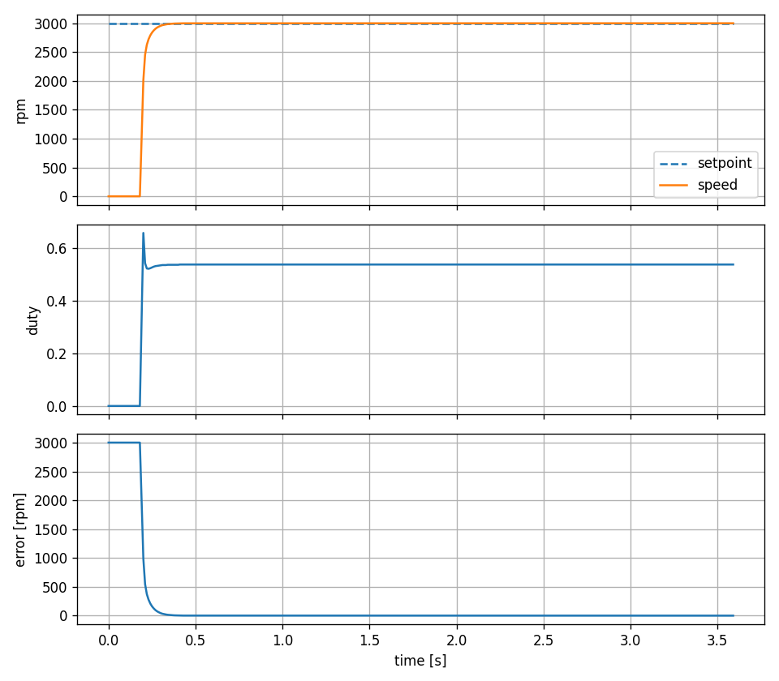
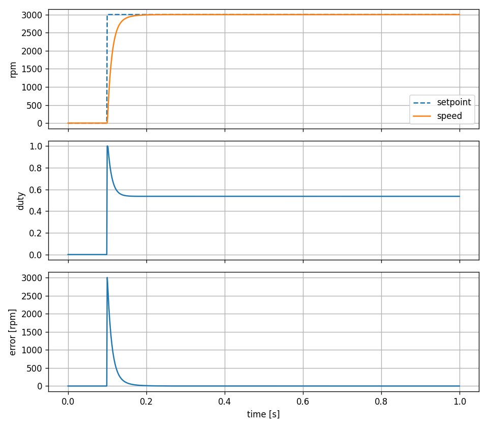
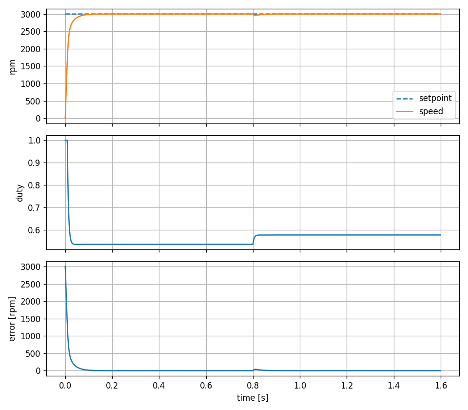
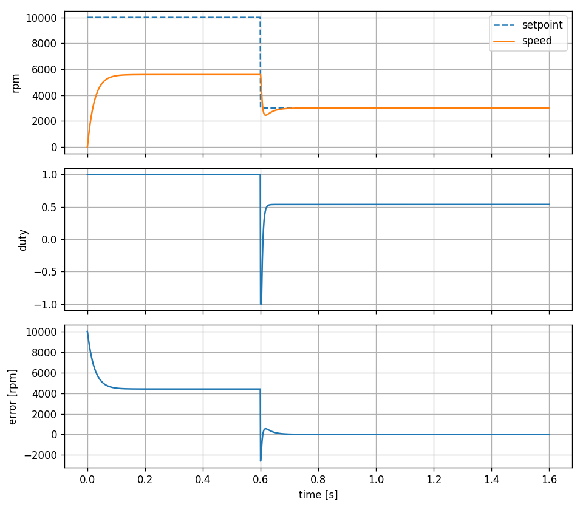
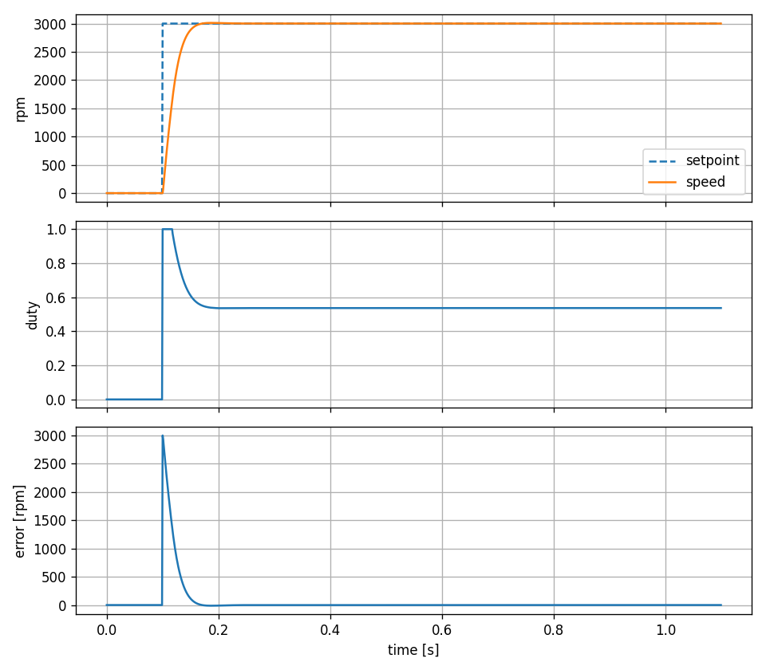
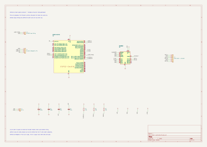

# esp32-motor-controller

A PID speed controller for a DC motor, running on an ESP32 (ESP32-WROOM-32 DevKit) in a
deterministic 1 kHz control loop. It is the device under test for the Krumpir HIL bench.

- The control logic lives in `lib/control/` as portable C (no ESP-IDF or FreeRTOS includes), so it
  is unit tested on the PC with Unity and reused unchanged on the target.
- A small I/O abstraction (`io_t`) lets the same controller run against a simulated motor, a real
  motor, or Krumpir. The firmware currently ships with the simulated motor.
- A serial console sets the setpoint and gains and starts/stops the controller. CSV telemetry
  streams at 100 Hz.
- Safety: latched overspeed and sensor-timeout faults, and a task watchdog that resets the board if
  the control loop hangs.

## Initial setup (Windows)

1. **PlatformIO**: install the VS Code "PlatformIO IDE" extension, or `pip install platformio`.
   The CLI is `~\.platformio\penv\Scripts\pio.exe`; add that folder to your PATH to use `pio`.
2. **Host C compiler** (needed for the `native` tests and the simulation tools): install MinGW-w64
   gcc, e.g. `winget install BrechtSanders.WinLibs.POSIX.UCRT`, and make sure `gcc --version`
   works in a new terminal.
3. **USB driver** for the DevKit's serial chip (CP210x or CH340, depending on the board) if the
   board does not show up as a COM port.

### Python (host tools)

Python 3.13. Packages are listed in `requirements.txt`. Set up a virtual environment in this folder:

```
cd krumpir\controllers\esp32-motor-controller
python -m venv .venv
.venv\Scripts\activate           # Windows (bash: source .venv/Scripts/activate)
pip install -r requirements.txt
```

## Build, test, flash

Run from this folder:

```
pio test -e native                    # unit tests on the PC
pio run -e esp32dev                   # build firmware
pio run -e esp32dev -t upload         # flash the board
pio device monitor                    # serial console, 115200 baud
```

## Using the controller

Open the serial monitor (`pio device monitor -p COM4`) and type commands at the `motor>` prompt.
The firmware boots stopped, with the tuned gains.

| Command | Effect |
|---|---|
| `sp <rpm>` | setpoint, within +-10000 |
| `kp` / `ki` / `kd <value>` | gains, finite and >= 0 |
| `start` / `stop` | run the controller / duty 0 and PID reset |
| `load <Nm>` | simulation only: load torque on the shaft, within +-0.1 |
| `inertia <scale>` | simulation only: rotor inertia scale, 0.1 to 10 (1 = nominal) |
| `clear` | clear a latched fault (overspeed, sensor timeout); `start` is refused until then |
| `status` | state, fault, gains, speed, duty, loop timing since the last `status` |
| `log on` / `log off` | CSV telemetry at 100 Hz: `t_ms,setpoint_rpm,speed_rpm,duty_permille` |

Example: `sp 3000`, `start`, then `status` shows the speed settling at 3000 rpm.

### Capture and plot a step response

Close the monitor first (the port can only be open once):

```
python tools/capture.py --port COM4 --duration 3 --cmd "start" "sp 3000" -o docs/capture.csv
python tools/plot.py docs/capture.csv docs/step_response_target.png
```

### Simulate on the PC

The same PID and motor model run on the PC (needs gcc and the venv above):

```
gcc -Ilib/control/include tools/step_response.c lib/control/src/pid.c lib/control/src/plant_sim.c lib/control/src/io_sim.c -lm -o .pio/step_response.exe
.pio/step_response.exe > docs/step_response.csv
python tools/plot.py docs/step_response.csv docs/step_response.png
```

Closed-loop scenarios (step, load, saturation, inertia) and the gain sweep are described in
[docs/tuning.md](docs/tuning.md).

## Results

Step to 3000 rpm:

| Measured on the board | Simulated on the PC |
|:---:|:---:|
|  |  |

Closed-loop scenarios (simulation):

| Load step | Saturation | Inertia change |
|:---:|:---:|:---:|
|  |  |  |

## Hardware

Intended wiring (the firmware currently simulates the motor; details and pin table in
[hardware/README.md](hardware/README.md)):



## Documentation

- [docs/tuning.md](docs/tuning.md): motor model, gain selection, scenarios and targets, fault behavior.
- [docs/timing.md](docs/timing.md): measured 1 kHz loop timing on the board.
- [docs/krumpir-interface.md](docs/krumpir-interface.md): what a test bench needs to drive and observe the controller.
- [hardware/README.md](hardware/README.md): KiCad schematic and pin table for the motor driver, encoder and Krumpir connections.
- [tools/README.md](tools/README.md): host scripts, including the timing check.

