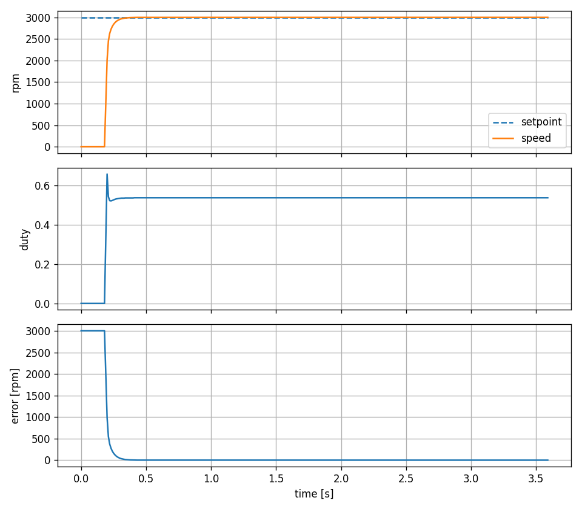
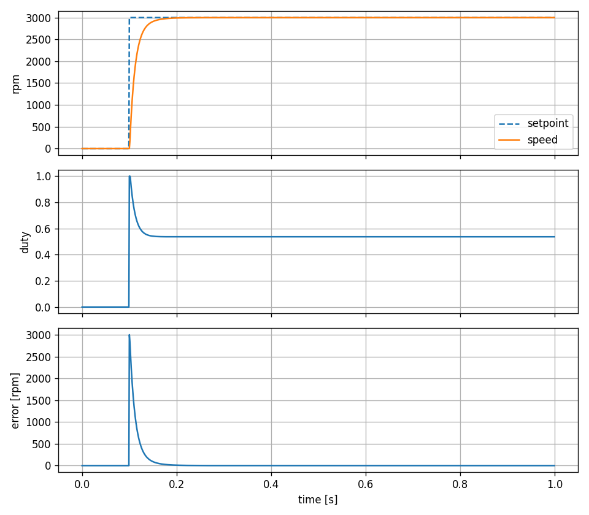
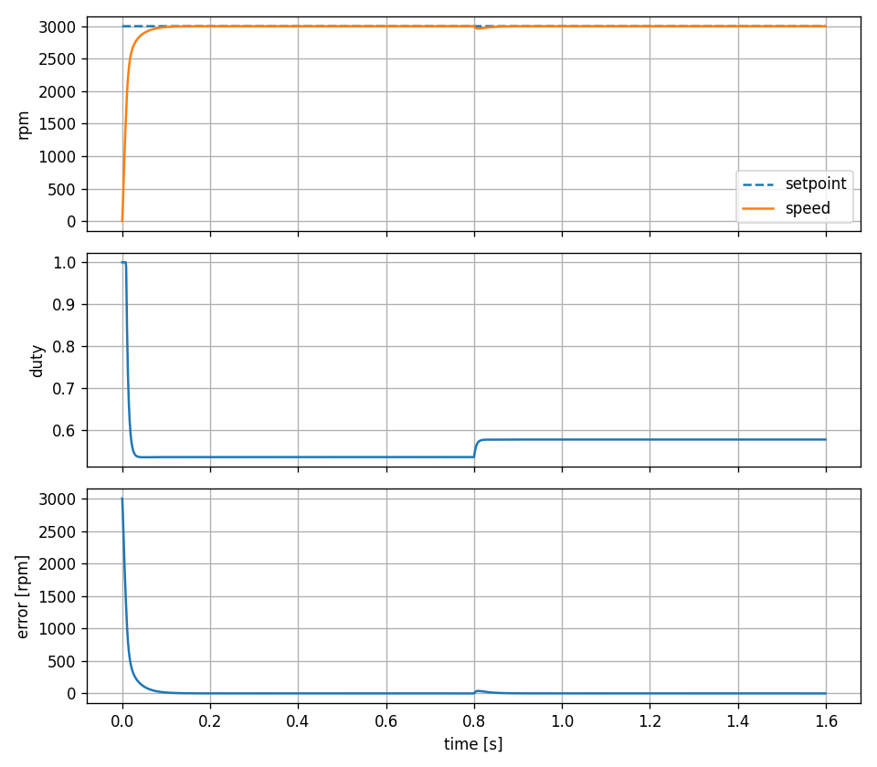
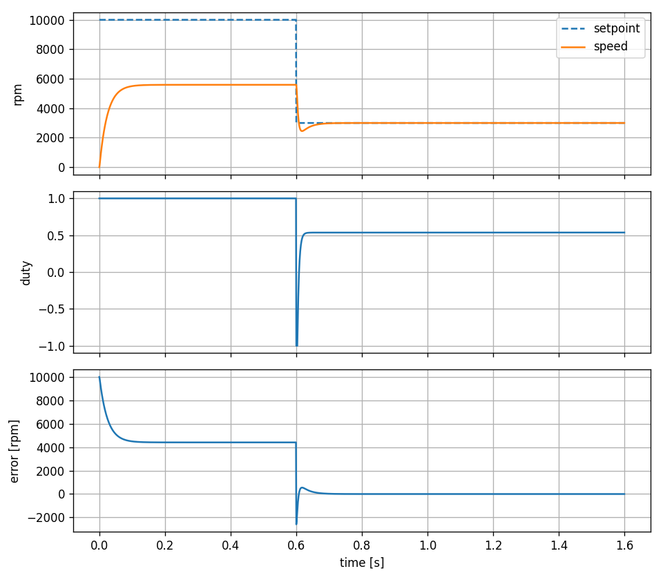
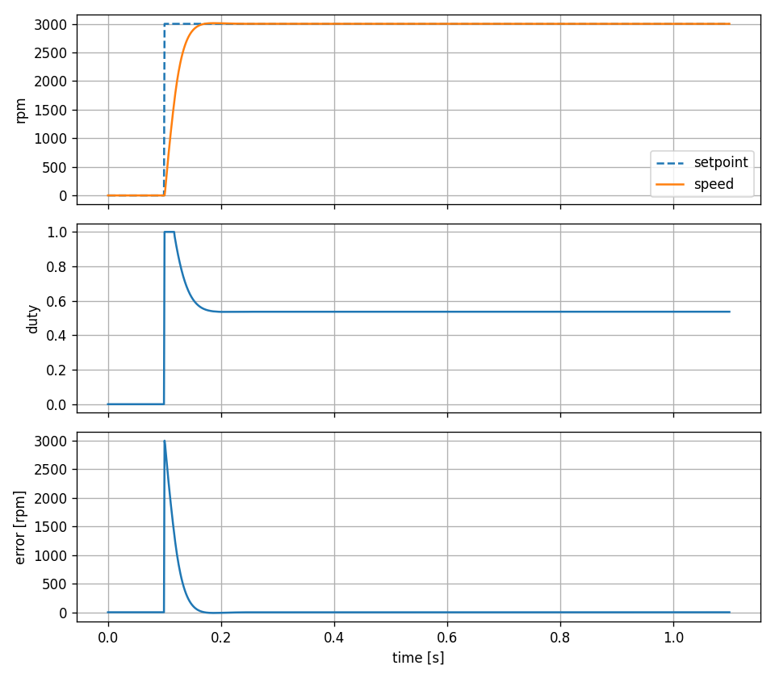
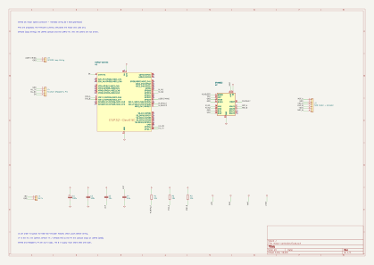

# ESP32 Motor Controller

A PID speed controller for a DC motor, running on an ESP32 in a 1 kHz control loop. It is a device
under test for the Krumpir HIL bench. Shared design, setup, build and console basics are in
[../README.md](../README.md).

- Control logic in `lib/motorctrl/` (`motor_loop`: the whole controller per tick); a small I/O
  abstraction (`motor_io_t`) runs it against a simulated motor, a real one, or Krumpir. The
  firmware ships with the simulated motor.
- CSV telemetry streams at 100 Hz.
- Safety: latched overspeed and sensor-timeout trips.

## Using the controller

Open the serial monitor and type commands at the `motor>` prompt (the common commands are in
[../README.md](../README.md#serial-console)).

| Command | Effect |
|---|---|
| `sp <rpm>` | setpoint, within +-10000 |
| `kp` / `ki` / `kd <value>` | gains, finite and >= 0 |
| `start` / `stop` | run the controller / duty 0 and PID reset |
| `load <Nm>` | simulation only: load torque on the shaft, within +-0.1 |
| `inertia <scale>` | simulation only: rotor inertia scale, 0.1 to 10 (1 = nominal) |
| `clear` | clear a latched trip (overspeed, sensor timeout); `start` is refused until then |
| `status` | state, trip, gains, speed, duty, loop timing since the last `status` |
| `log on` / `log off` | CSV telemetry at 100 Hz: `t_ms,setpoint_rpm,speed_rpm,duty_permille` |

Example: `sp 3000`, `start`, then `status` shows the speed settling at 3000 rpm.

### Capture a run and check the loop timing

Close the monitor first. Record and plot a step response:

```
python ../../tools/serial/capture.py --port COM4 --duration 3 --cmd "start" "sp 3000" -o docs/capture.csv
python tools/plot.py docs/capture.csv docs/step_response_target.png
```

The timing check (PASS or FAIL) and its limits are in [tools/README.md](tools/README.md).

### Measure and calibrate over XCP

Calibration page `motor_cal_page` (setpoint and gains). Setup and cost on the loop:
[../../libs/esp/xcpglue/README.md](../../libs/esp/xcpglue/README.md).

```
pio run -e esp32dev-xcp -t upload
xcpclient --offline --udp --dest-addr <ip> --elf .pio/build/esp32dev-xcp/firmware.elf --a2l docs/motor.a2l --elf-unit-filter control_task --default-event tick --embed-aml
xcpclient --udp --dest-addr <ip> --a2l docs/motor.a2l --mea s_loop.speed s_loop.duty --time 10 --csv docs/xcp.csv
```

### Simulate on the PC

The same PID and motor model run on the PC (needs gcc and the venv, see [../README.md](../README.md#initial-setup-windows)):

```
gcc -Ilib/motorctrl/include -I../../libs/ctrlcore/include -I../../libs/plants/dcmotor/include tools/step_response.c lib/motorctrl/src/motor_io_sim.c lib/motorctrl/src/motor_ctrl.c lib/motorctrl/src/motor_safety.c lib/motorctrl/src/motor_loop.c ../../libs/ctrlcore/src/pid.c ../../libs/plants/dcmotor/src/plant_sim.c -lm -o .pio/step_response.exe
.pio/step_response.exe > docs/step_response.csv
python tools/plot.py docs/step_response.csv docs/step_response.png
```

Closed-loop scenarios (step, load, saturation, inertia) and the gain sweep: [docs/tuning.md](docs/tuning.md).

## Results

Step to 3000 rpm:

| Measured on the board | Simulated on the PC |
|:---:|:---:|
|  |  |

Closed-loop scenarios (simulation):

| Load step | Saturation | Inertia change |
|:---:|:---:|:---:|
|  |  |  |

## Hardware

Intended wiring; the firmware simulates the motor, so no motor pins are driven. Pin table in
[hardware/README.md](hardware/README.md).



## Documentation

- [docs/tuning.md](docs/tuning.md): motor model, gain selection, scenarios and targets, trip behavior.
- [docs/timing.md](docs/timing.md): measured 1 kHz loop timing on the board.
- [docs/krumpir-interface.md](docs/krumpir-interface.md): what a test bench needs to drive and observe the controller.
- [hardware/README.md](hardware/README.md): KiCad schematic and pin table.
- [tools/README.md](tools/README.md): host scripts, including the timing check.
