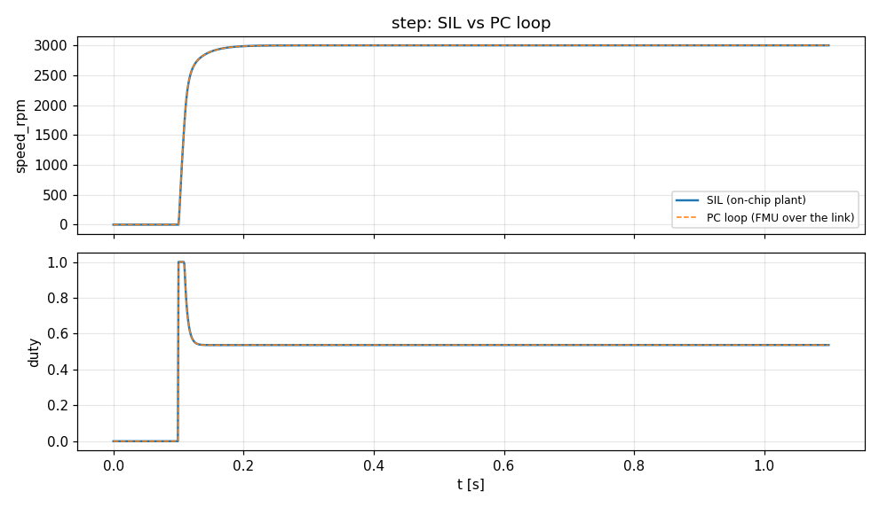
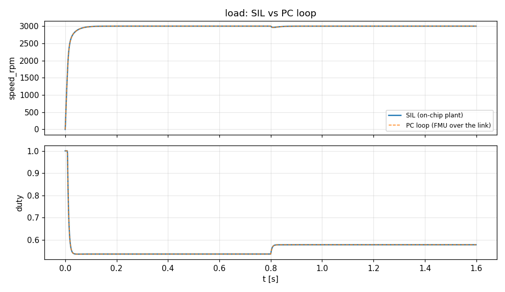
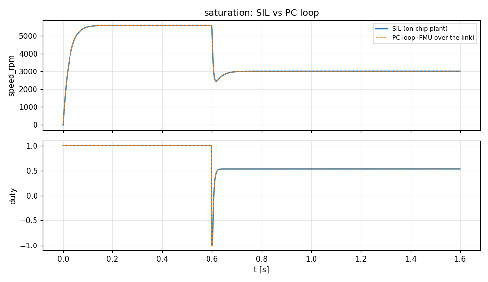
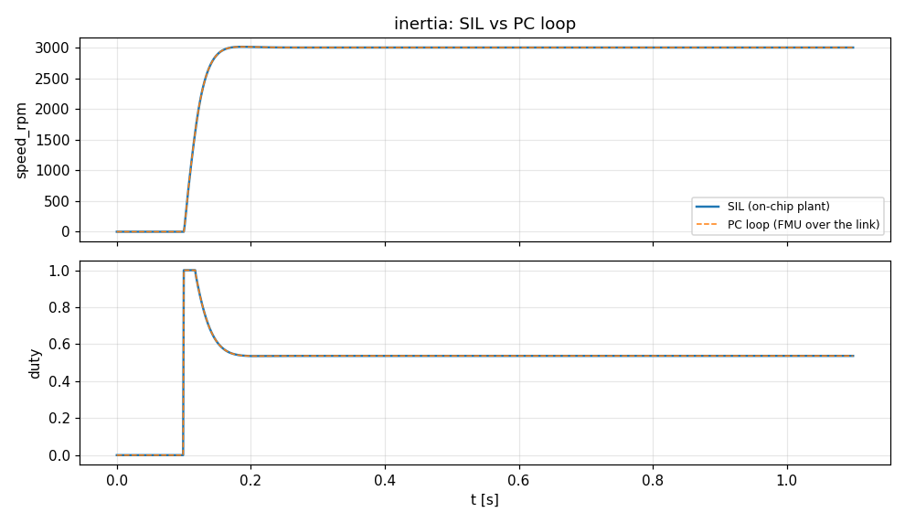

# motor: SIL vs PC loop

Generated by `tools/hil/compare.py motor`: each closed-loop scenario on the controller's on-chip plant (SIL) and as the PC loop (the same controller code against the plant FMU in the runner over the HIL link). RMS error in % of full scale (the largest SIL value of the signal); figures and trips SIL / PC. Pass: RMS under 2 %, figures within 10% (or a small floor), the same trip.

| case | result | RMS error | figures (SIL / PC) | trip (SIL / PC) |
|---|---|---|---|---|
| step | PASS | speed_rpm 0.00 %, duty 0.00 % | overshoot % 0 / 0, settling s 0.063 / 0.063, final error 0 / 0.000818, min 0 / 0 | none / none |
| load | PASS | speed_rpm 0.00 %, duty 0.00 % | overshoot % 0 / 0, settling s 0 / 0, final error 0 / 0.000818, min 2.96e+03 / 2.96e+03 | none / none |
| saturation | PASS | speed_rpm 0.00 %, duty 0.00 % | overshoot % 0 / 0, settling s 0.077 / 0.077, final error 0 / 0.000818, min 2.45e+03 / 2.45e+03 | none / none |
| inertia | PASS | speed_rpm 0.00 %, duty 0.00 % | overshoot % 0.4 / 0.401, settling s 0.055 / 0.055, final error 0 / 0.000818, min 0 / 0 | none / none |

