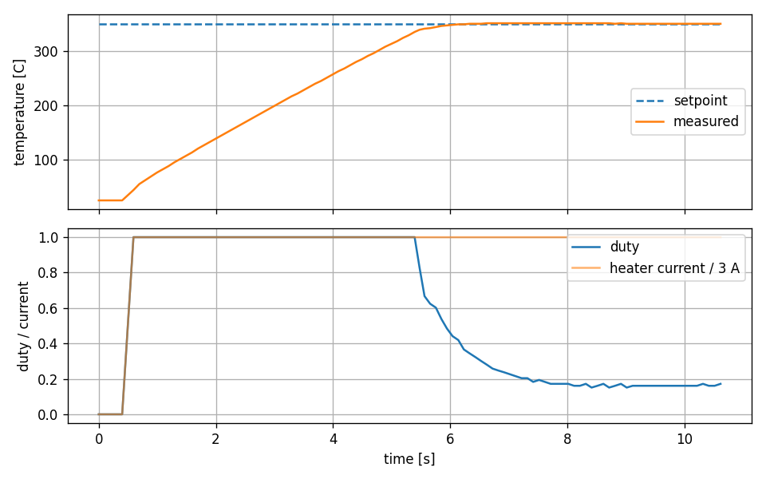
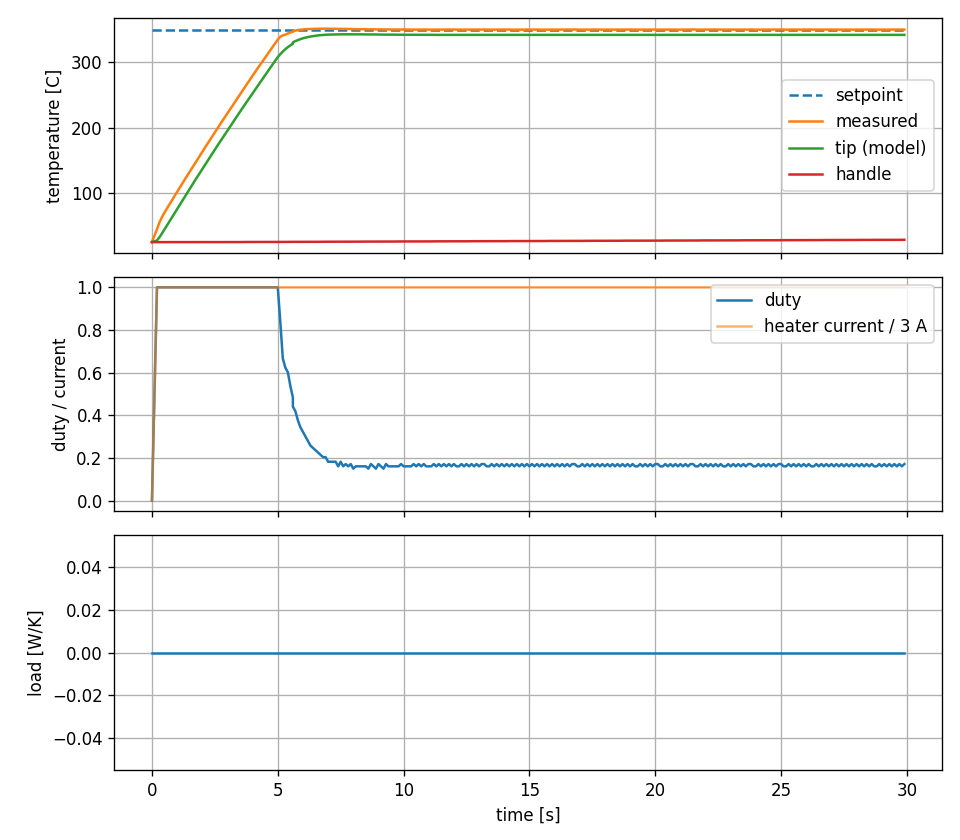
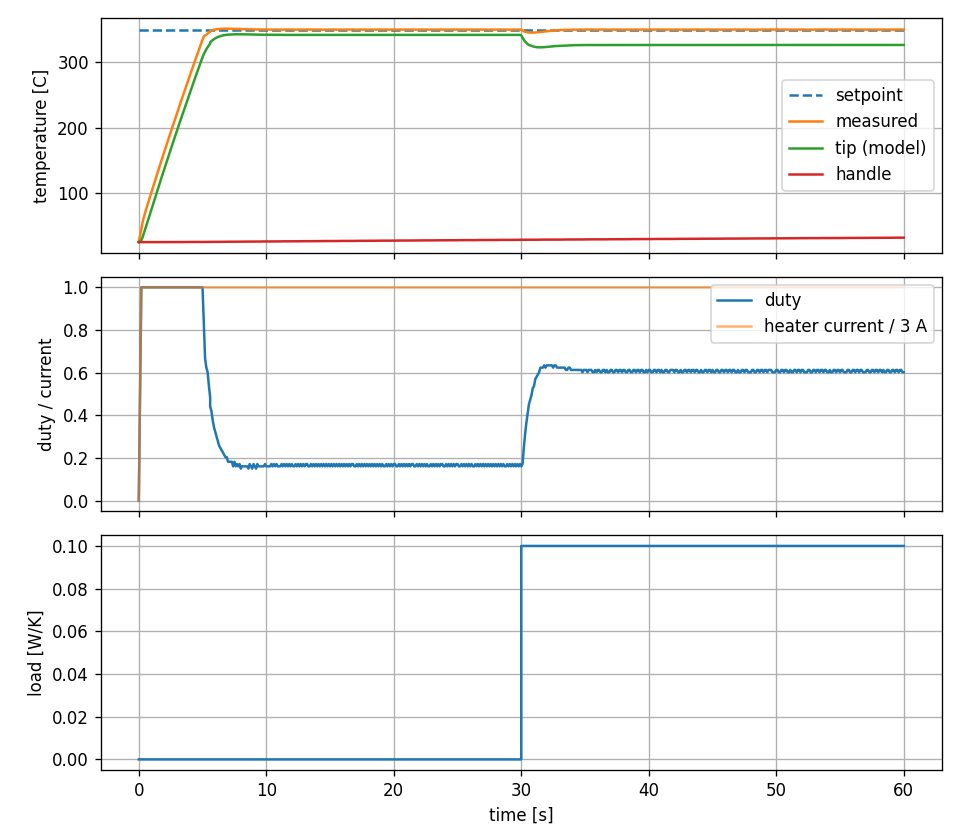
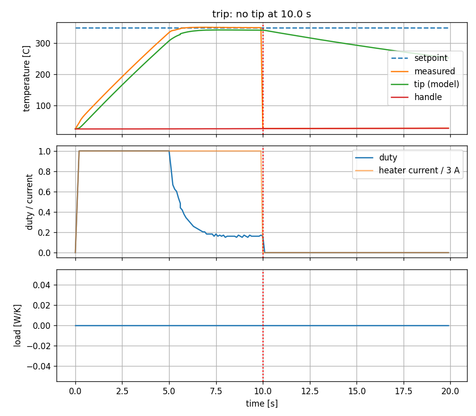
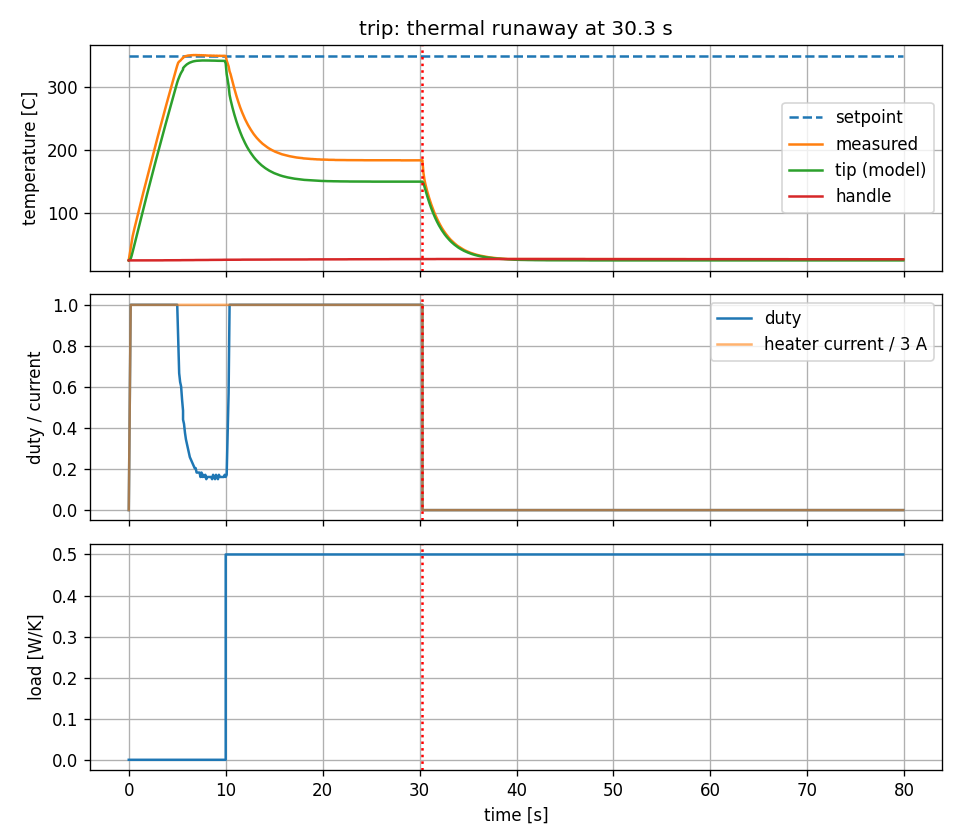
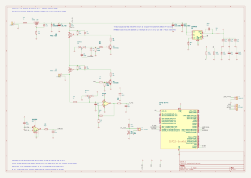

# ESP32 T12 Soldering Tip Controller

A temperature controller for a T12 / T15 soldering tip, running on an ESP32 in a 1 kHz control
loop with a 100 ms heater cycle. It is a device under test for the Krumpir HIL bench. Shared design,
setup, build and console basics are in [../README.md](../README.md). The tip, its thermocouple
front end and the protected 24 V power stage are described in
[../../docs/T12 Controller Design.md](../../docs/T12%20Controller%20Design.md).

- Control logic in `lib/t12ctrl/`, tip model in `libs/plants/t12`. A small I/O abstraction
  (`t12_io_t`: heater, thermocouple, handle NTC, heater current, heartbeat) runs it against the
  simulated tip or the real board. All readings are raw ADC counts.
- One heater cycle lasts 100 ms: heat, wait for the switching artifact to settle, average the
  thermocouple while the heater is off, then update the PID.
- The console also injects tip faults. CSV telemetry streams at 10 Hz.
- Safety: latched trips for over temperature, a stuck heater switch, a short, a missing tip, a
  wrong heater resistance, invalid readings and thermal runaway. A trip also stops the heartbeat
  that keeps the series switch on.

## Using the controller

Open the serial monitor and type commands at the `t12>` prompt (the common commands are in
[../README.md](../README.md#serial-console)). The firmware boots with setpoint 350 C.

| Command | Effect |
|---|---|
| `sp <degC>` | setpoint, 100 to 450 |
| `kp` / `ki` / `kd <value>` | gains, finite and >= 0 |
| `ramp <K/s>` | setpoint ramp rate, 0 = off |
| `start` / `stop` | run the controller / duty 0 and PID reset |
| `load <W/K>` | simulation only: heat drawn by touching a joint, 0 to 1 |
| `ambient <degC>` | simulation only: room temperature, -20 to 60 |
| `fault none/open/short/stuck` | simulation only: inject a tip fault |
| `clear` | clear a latched trip; `start` is refused until then |
| `status` | state, trip, tip and handle temperature, duty, heater current, loop timing since the last `status` |
| `log on` / `log off` | CSV telemetry at 10 Hz: `t_ms,setpoint_c,temp_c,duty_permille,current_ma` |

Example: `sp 350`, `start`, then `status` shows the tip settling at 350 C after about 5 s.

### Capture a run and check the loop timing

Close the monitor first. Record and plot a cold start:

```
python ../../tools/serial/capture.py --port COM4 --duration 10 --cmd "sp 350" "start" -o docs/capture.csv
python tools/plot.py docs/capture.csv docs/cold_start_target.png
```

The timing check (PASS or FAIL) and its limits are in [tools/README.md](tools/README.md).

### Measure and calibrate over XCP

Calibration page `t12_cal_page` (setpoint and gains). Setup and cost on the loop:
[../../libs/esp/xcpglue/README.md](../../libs/esp/xcpglue/README.md).

```
pio run -e esp32dev-xcp -t upload
xcpclient --offline --udp --dest-addr <ip> --elf .pio/build/esp32dev-xcp/firmware.elf --a2l docs/t12.a2l --elf-unit-filter control_task --default-event tick --embed-aml
xcpclient --udp --dest-addr <ip> --a2l docs/t12.a2l --mea s_loop.temp s_loop.duty s_loop.amps --time 10 --csv docs/xcp.csv
```

### Simulate on the PC

The same controller, tip model and safety supervisor run on the PC (needs gcc and the venv, see [../README.md](../README.md#initial-setup-windows)):

```
gcc -Ilib/t12ctrl/include -I../../libs/ctrlcore/include -I../../libs/plants/t12/include tools/scenarios.c lib/t12ctrl/src/t12_scenario.c lib/t12ctrl/src/t12_loop.c lib/t12ctrl/src/t12_ctrl.c lib/t12ctrl/src/t12_cycle.c lib/t12ctrl/src/t12_convert.c lib/t12ctrl/src/t12_safety.c lib/t12ctrl/src/t12_io_sim.c ../../libs/ctrlcore/src/pid.c ../../libs/ctrlcore/src/step_metrics.c ../../libs/plants/t12/src/t12_plant.c -lm -o .pio/scenarios.exe
.pio/scenarios.exe cold > docs/scenario_cold.csv
python tools/plot.py docs/scenario_cold.csv docs/scenario_cold.png
```

Closed-loop scenarios (cold start, joint load, ambient change, each fault) and the gain sweep: [docs/tuning.md](docs/tuning.md).

## Results

Cold start to 350 C (the board runs the simulated tip, so this compares the firmware on the ESP32
with the same code on the PC):

| On the board | Simulated on the PC |
|:---:|:---:|
|  |  |

On the board the tip reaches 350 C about 5.7 s after heating starts (6.0 s in the simulation) and
then holds 350 to 351 C with a duty of about 0.16 and a heater current of 3.00 A.

Closed-loop scenarios (simulation):

| Joint load | Missing tip | Thermal runaway |
|:---:|:---:|:---:|
|  |  |  |

## Hardware

Intended circuit; the firmware simulates the tip. Details, pin table and the values to check in
[hardware/README.md](hardware/README.md).



## Documentation

- [docs/tuning.md](docs/tuning.md): tip model, gain selection, scenarios and targets, trips.
- [docs/krumpir-interface.md](docs/krumpir-interface.md): what a test bench needs to drive and observe the controller.
- [hardware/README.md](hardware/README.md): KiCad schematic and pin table for the protected 24 V power stage.
- [tools/README.md](tools/README.md): host scripts, including the timing check.
- [../../docs/T12 Controller Design.md](../../docs/T12%20Controller%20Design.md): the circuit design and its fault table.
