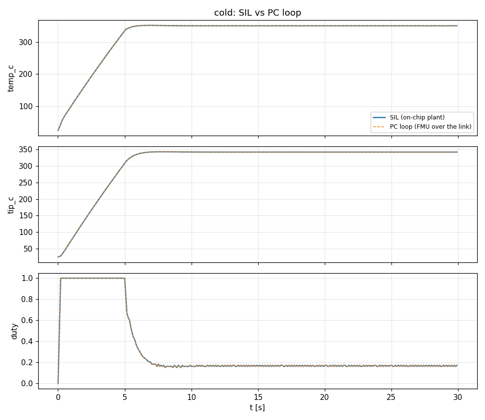
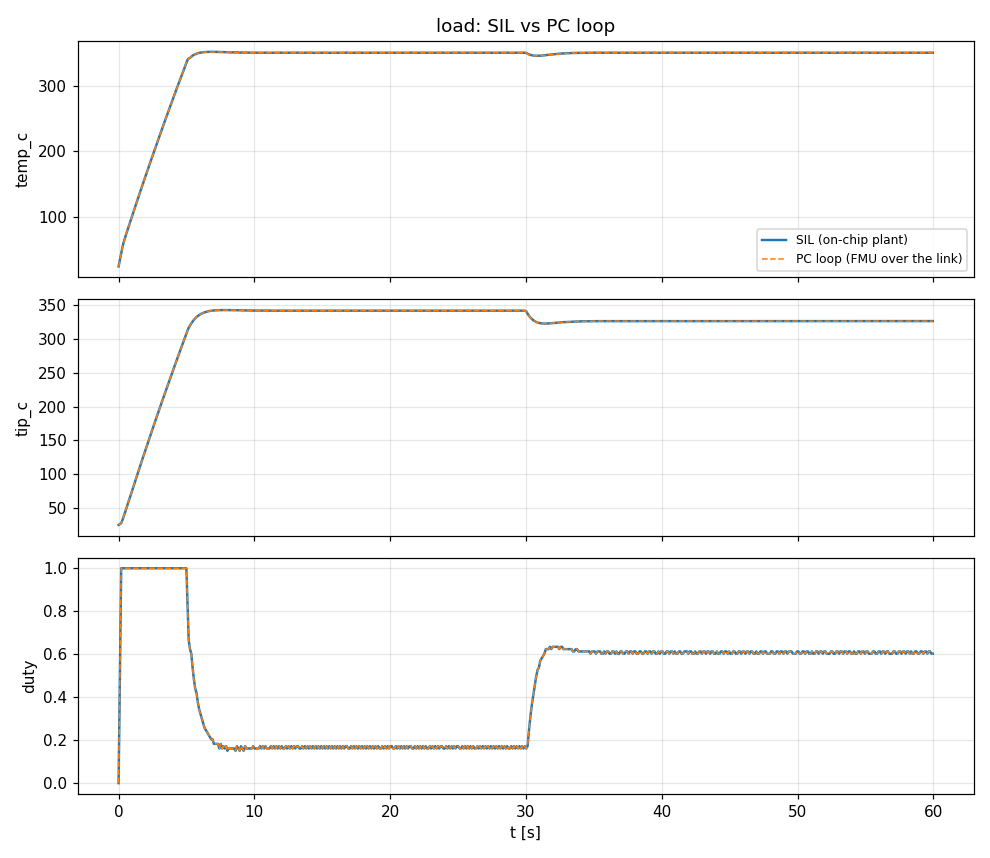
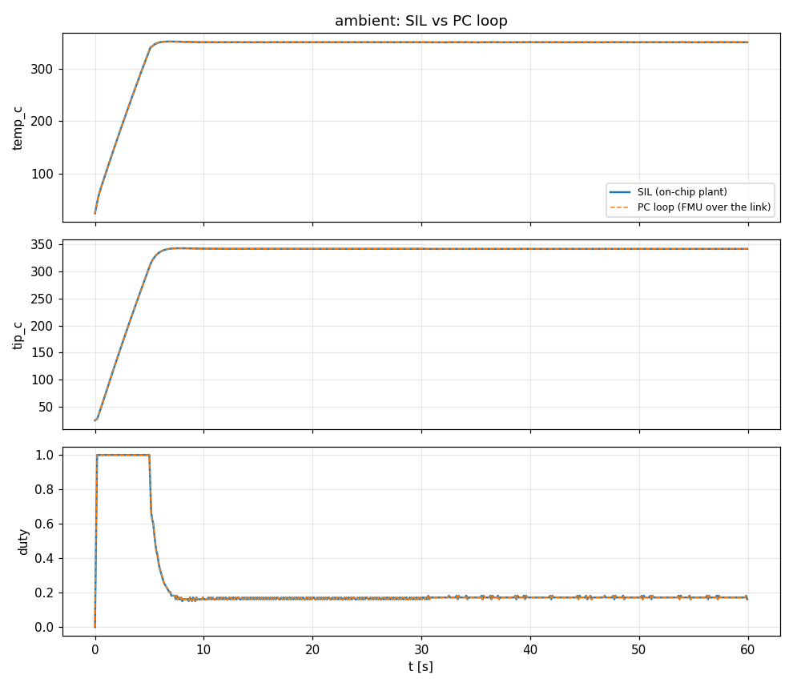
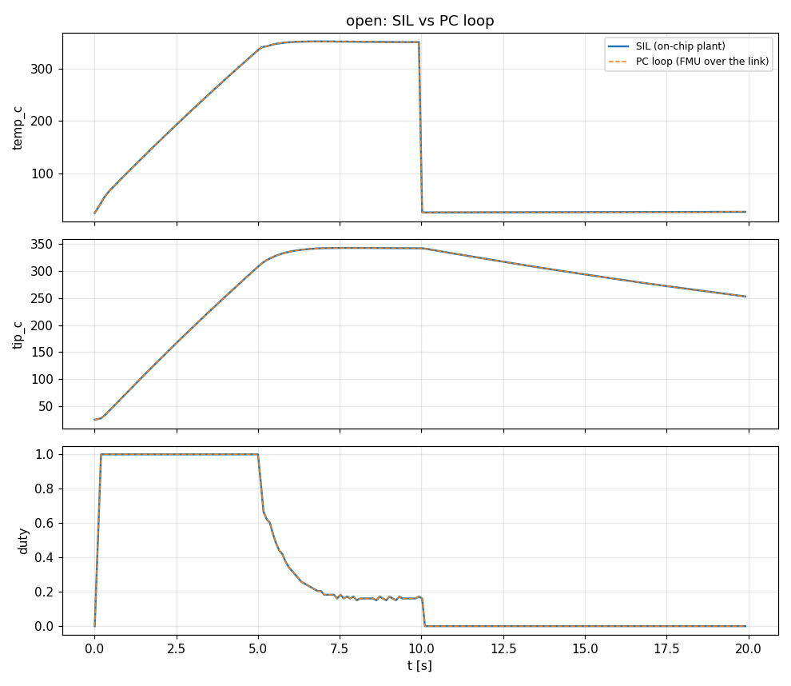
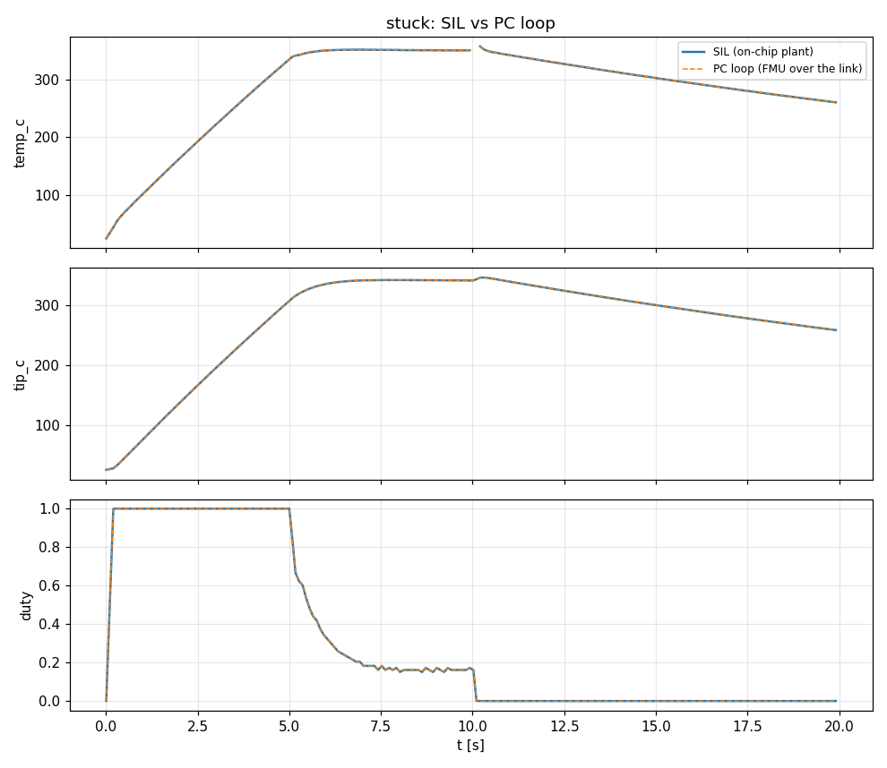
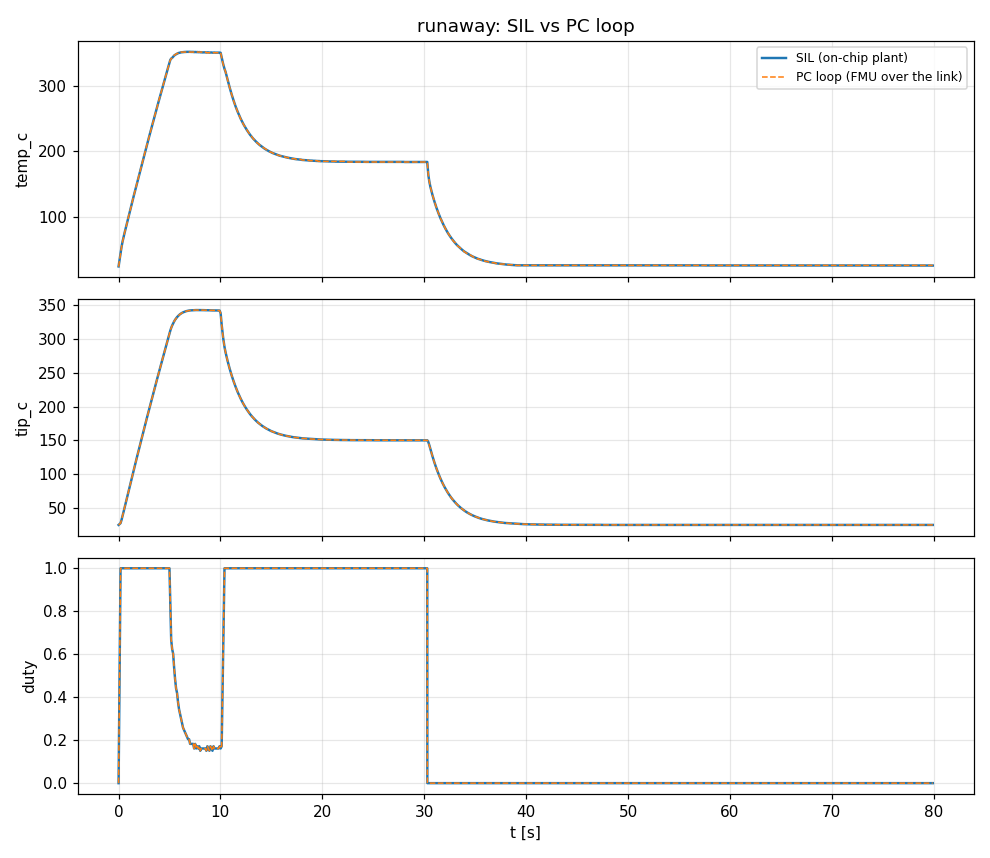

# t12: SIL vs PC loop

Generated by `tools/hil/compare.py t12`: each closed-loop scenario on the controller's on-chip plant (SIL) and as the PC loop (the same controller code against the plant FMU in the runner over the HIL link). RMS error in % of full scale (the largest SIL value of the signal); figures and trips SIL / PC. Pass: RMS under 2 %, figures within 10% (or a small floor), the same trip.

| case | result | RMS error | figures (SIL / PC) | trip (SIL / PC) |
|---|---|---|---|---|
| cold | PASS | temp_c 0.05 %, tip_c 0.01 %, duty 0.02 % | overshoot % 0.4 / 0.286, settling s 5.26 / 5.26, final error 0 / 0, min 25.4 / 25 | none / none |
| load | PASS | temp_c 0.05 %, tip_c 0.01 %, duty 0.02 % | overshoot % 0.0571 / 0, settling s 0 / 0, final error 0.00667 / 0, min 345 / 345 | none / none |
| ambient | PASS | temp_c 0.04 %, tip_c 0.01 %, duty 0.02 % | overshoot % 0.0571 / 0, settling s 0 / 0, final error 0.0167 / 0, min 350 / 350 | none / none |
| open | PASS | temp_c 0.09 %, tip_c 0.01 %, duty 0.01 % | trip after s 0.021 / 0.021 | no tip / no tip |
| short | PASS | temp_c 0.09 %, tip_c 0.01 %, duty 0.01 % | trip after s 0.021 / 0.021 | heater short / heater short |
| stuck | PASS | temp_c 0.08 %, tip_c 0.01 %, duty 0.01 % | trip after s 0.021 / 0.021 | heater stuck on / heater stuck on |
| runaway | PASS | temp_c 0.06 %, tip_c 0.01 %, duty 0.01 % | trip after s 20.3 / 20.3 | thermal runaway / thermal runaway |

