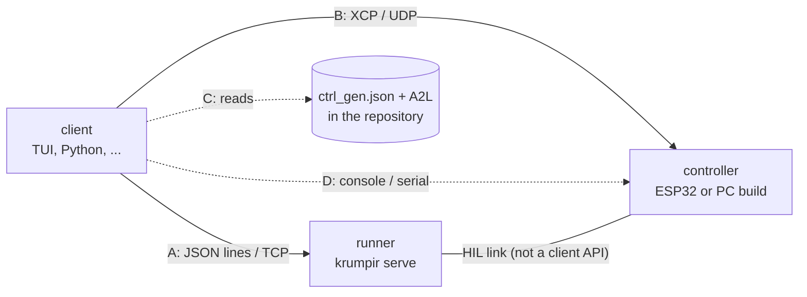
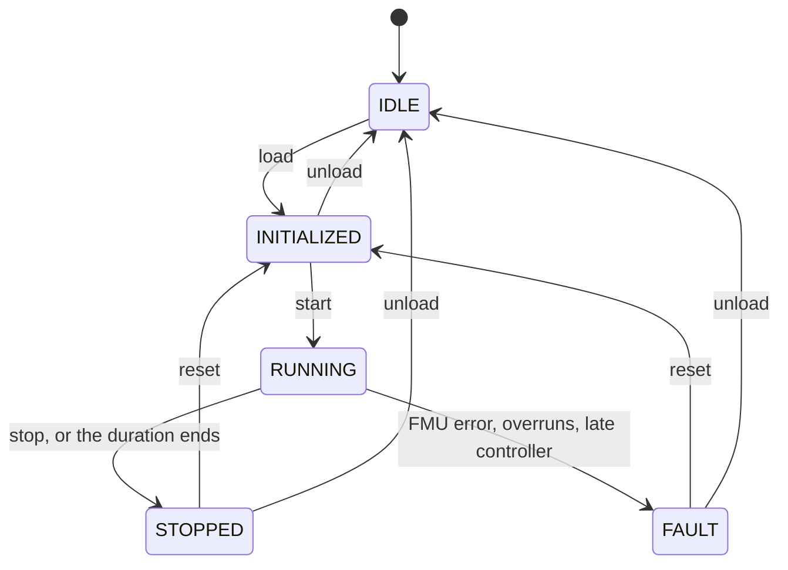

# Krumpir client API specification

What a client (the TUI, the Python client, a GUI or CI tool) may rely on when it talks to a runner
or a controller. It describes the interfaces as the code implements them (protocol 1), states the
rules for changing them, and lists what limits them.

Words: **must** is a rule a conforming server or client keeps; **should** is a recommendation.

Contents: [1 Surfaces](#1-surfaces) · [2 Runner service](#2-runner-service) ·
[3 Controller access](#3-controller-access) · [4 Client library contract](#4-client-library-contract) ·
[5 Compatibility rules](#5-compatibility-rules) · [6 Evaluation](#6-evaluation) ·
[7 Deliberately not done](#7-deliberately-not-done) · [8 Change checklist](#8-change-checklist)

## 1. Surfaces

| # | Surface | Server | Transport | Version marker | Clients |
|---|---|---|---|---|---|
| A | Runner service (model access) | `krumpir serve` (`runner/src/app/serve.c`) | TCP, JSON lines, default `127.0.0.1:7700` | `info.protocol` = 1 | TUI `service.*` + `model.*`, Python `Testbench` / `MAPort` |
| B | Controller measurement and calibration | XCPlite in the firmware and in the PC build | XCP on UDP, port 5555 (board), 5555 motor / 5556 t12 (PC build) | EPK (per build) | TUI `xcp.*` + `a2l.*` + `ecu_model.*`, Python `EcuPort`, `xcpclient` |
| C | Controller description | `controllers/<dir>/src/gen/ctrl_gen.json` (generated) + the A2L it names | files in the repository | `schema` (1) | TUI (`--repo`) |
| D | Controller console | firmware, UART0 115200 8N1 | text lines | none | `tools/serial/*.py`, a person |
| E | Files | runner's working directory | scenario TOML, log CSV | none | all |

Not client APIs, and outside this specification: the HIL link between runner and controller
(`libs/hil`, versioned by `HIL_VERSION` and the names hash in HELLO), the FMI interface, and
`krumpir run|info|init` on the command line.

## 2. Runner service

### 2.1 Transport and framing

- TCP over IPv4. The address is `host:port`; the default port is 7700. No TLS, no authentication:
  the service must only listen on loopback or a trusted LAN.
- One JSON object per line (`\n`; a `\r` before it is accepted) in each direction, UTF-8. A blank
  line is ignored. A request line may be up to 8 MiB; a longer one gets
  `{"ok":false,"code":"limit","error":"request line too long"}` and the connection is closed.
- Strict request/reply: every request gets exactly one reply, in order. The server never sends
  anything unasked (no events, no streaming).
- **One client at a time.** A second connection gets one line,
  `{"ok":false,"code":"busy","error":"another client is connected"}`, and is closed; the first
  client is not disturbed. A client that receives `busy` reports that the service is in use.
  A client must still put a timeout on every call.
- The session belongs to the service, not the connection. A run survives its client; the next
  client must read `state` before assuming anything.

### 2.2 Envelope

Request: `{"op": string, "tag"?: any, ...arguments}`.
Reply: `{"tag"?: <copied>, "ok": true, ...results}` or
`{"tag"?: <copied>, "ok": false, "code": string, "error": string}`.

- A failed reply carries nothing but `tag`, `ok`, `code` and `error`.
- `code` is the failure class; a client branches on it. The set is closed:

  | `code` | When |
  |---|---|
  | `bad_request` | not JSON, no `op`, unknown `op`, a wrong or missing argument |
  | `bad_state` | the op is not allowed in this state (2.3) |
  | `not_found` | no such variable, file, capture or FMU |
  | `not_writable` | output, fixed parameter, unmapped input |
  | `bad_scenario` | the scenario does not parse or does not match its FMU |
  | `exists` | `save` without `overwrite` |
  | `limit` | too many captures, too large a buffer, line or file |
  | `timeout` | the loop did not answer |
  | `fault` | the FMU or the I/O backend returned an error |
  | `internal` | out of memory and the like |
  | `busy` | another client is connected (2.1) |

  A client maps a code it does not know to `internal`.
- `error` is one line of English for a person. Its text is not part of the contract; a client
  shows it and must not parse it.
- Unknown argument keys are ignored. A client must not send keys this document does not name; an
  added key may be given a meaning.
- A reply may gain keys. A client must ignore keys it does not know.
- Numbers are JSON doubles printed with 17 significant digits. A non-finite value is `null`.

### 2.3 Session states

`LOADED` is in the state list but a client never observes it (`load` goes through it). A failed
`load` or a failed reload inside `reset` leaves `IDLE`. `fault` (the reason) stays readable after
`unload`, until the next `load`.

| Operation | IDLE | INITIALIZED | RUNNING | STOPPED | FAULT |
|---|---|---|---|---|---|
| `info`, `state`, `files`, `text`, `init`, `describe`, `check`, `save`, `wait`, `stop`, `unload` | yes | yes | yes | yes | yes |
| `load` | yes | no | no | no | no |
| `variables` | no | yes | yes | yes | yes |
| `start` | no | yes | no | no | no |
| `reset` | no | no | no | yes | yes |
| `read` | no | yes | yes | yes | no |
| `write`, `signal`, `capture_start` | no | yes | yes | no | no |
| `capture_fetch`, `capture_stop`, `capture_free` | no | yes | yes | yes | yes |

`stop` and `unload` never fail: in a state where they have nothing to do they reply with the
state as it is (`unload` in `IDLE` gives a zero summary whose `state` is `IDLE`).

### 2.4 Operations

Types: `Name` is a model variable name (at most 63 bytes). `Path` is a path on the server,
relative to the directory the service was started in. `State` is one of the six state names.

**Service**

| `op` | Arguments | Result |
|---|---|---|
| `info` | | `protocol`: integer, `version`: string (the runner's build), `limits`: Limits, `state`: State, `fault`: string |
| `files` | | `scenarios`: [Path] (`scenarios/*.toml`), `fmus`: [Path] (`fmus/*.fmu`), each sorted, not recursive, at most 256 |
| `text` | `path`: Path ending in `.toml` (up to 1 MiB) or `runs/<...>.csv`; for a `.csv`: `from`: line = 0 (the header is line 0), `max`: lines = all | `text`: string; for a `.csv` also `from`, `lines`: lines returned, `more`: bool (false at the end of the file). A page holds at most 1 MiB and at least one line; a last line still being written is left for the next page |

`text` on a log reads it in pages: the lines from `from` on, at most `max`. A client reads a log
of any length by paging.

**Scenario authoring** (no effect on the session)

| `op` | Arguments | Result |
|---|---|---|
| `init` | `fmu`: Path | `toml`: the starter scenario |
| `describe` | exactly one of `scenario`: Path, `toml`: string, `fmu`: Path | `text`: string; `scenario`: Scenario (absent when the text does not parse); `variables`: [Variable] (absent when the FMU cannot be opened); `problem`: string (present when either is absent) |
| `check` | `toml`: string | |
| `save` | `path`: `scenarios/<name>.toml` (no subfolder, no leading dot, name at most 100 bytes), `toml`: string, `overwrite`: bool = false | |

`describe` replies `ok: true` with a `problem` for a scenario that is wrong; `ok: false` only when
its own arguments are wrong or the file cannot be read. `check` and `save` apply every check of
`load` (including the `log.file` rule below) without creating an instance or a log.

**Run control**

| `op` | Arguments | Result |
|---|---|---|
| `load` | exactly one of `scenario`: Path, `toml`: string | `state`, `fault` |
| `start` | | `state`, `fault` |
| `stop` | | `state`, `fault`; returns after the loop has ended |
| `wait` | `timeout_ms`: number (absent or negative: forever; 0: a poll) | `done`: bool, `state`, `fault` |
| `reset` | | `summary`: Summary of the ended run, `state`, `fault` |
| `unload` | | `summary`: Summary, `state`, `fault` |
| `state` | | `state`, `fault`; once loaded also Status |

- Under the service `log.file` must be `runs/<...>.csv` (subfolders allowed, no part starting with
  a dot). `load`, `check` and `save` refuse any other.
- `wait` holds its reply until the run has ended or the timeout is up. A client must pass a
  `timeout_ms` below its own call timeout and loop (the Python client uses 1 s slices).
- `reset` reloads the same scenario: a fresh FMU at t = 0 with the scenario's stimuli. Values
  written and signals set during the ended run are gone, and so are its captures. The log file is
  continued (rows appended, `n` and `t` counting on).

**Variables**

| `op` | Arguments | Result |
|---|---|---|
| `variables` | | `variables`: [Variable], every variable of the FMU, any type |
| `read` | `names`: [Name] | `values`: {Name: number or null}, `t`: s |
| `write` | `values`: {Name: number} | |
| `signal` | `stimulus`: Stimulus | |

- Only Float64 variables can be read or written. Any Float64 variable can be read. Writable are the
  scenario's `io.inputs` and tunable parameters; a fixed parameter, an output and an unmapped
  input are refused (`not_writable`).
- `read` samples all its names at one step boundary; `t` is the run time of that boundary. A
  `write` applies all its values at one boundary, or none when one of them is refused. While
  `RUNNING`, the boundary is the next step and the reply comes after it. A `read` of any number
  of names costs one step. A command the loop does not answer within 2 s fails (`timeout`).
- A `write` to an input, and a `signal`, replace that input's value or signal from then on: from
  t = 0 when `INITIALIZED`, from the next step when `RUNNING` (a signal's own time starts there).
- At most 64 commands can be queued to the loop (one client, one request at a time, never reaches it).

**Captures**

| `op` | Arguments | Result |
|---|---|---|
| `capture_start` | `vars`: [Name] = all inputs then all outputs; `start`, `stop`: Condition; `duration`: s; `max_rows`: integer | `id`: integer |
| `capture_fetch` | `id`; `from`: row = 0; `max`: rows = all | `capture_state`: `ARMED`, `RUNNING` or `FINISHED`; `n_rows`: rows recorded so far; `from`; `names`: [`"t"`, Name...]; `rows`: [[t, v...]] |
| `capture_stop` | `id` | |
| `capture_free` | `id` | |

- `vars` and trigger variables must be among the scenario's `io.inputs` and `io.outputs` (at most
  32 names). `t` is the time at the end of the step, as in the log.
- `start` absent: recording begins with the next step. `stop` is checked on each recorded row and
  that row is kept. `max_rows` default: `duration / step + 1`, or 100000; a capture is `FINISHED`
  when its buffer is full. The buffer is limited to 256 MB.
- Ids are 0 to 7, per load. `capture_stop` ends the recording and keeps the rows; `capture_free`
  discards the capture and gives its id back for the next `capture_start`; `unload` and `reset`
  free all. All captures are `FINISHED` once the run has ended.
- `capture_fetch` costs only the rows it returns, however long the capture is, so a client may
  poll with `from` set to the rows it has. `max: 0` returns the state and `n_rows` without rows.
  Fetch large captures in pages.

### 2.5 Data types

**Variable** `{name, vr: integer, type: string, causality: string, tunable: bool, unit: string,
start: string, description: string, min: number|null, max: number|null}`. `type` is the FMI type
(`Float64`, `Int32`, ...); `causality` is the FMI word (`input`, `output`, `parameter`, `local`,
...); `unit`, `start` and `description` are `""` when the FMU leaves them out. `start` is the XML
text, not a number. `min` and `max` are the FMU's limits, `null` when it gives none (or the type has
none); a client may check a `write` against them.

**Status** (in `state` once loaded) `{fmu: Path, scenario: Path|null, step: s, duration?: s
(absent: until stopped), t: s, steps, overruns, max_wake_ns, max_step_ns, late}` for the run so
far. `t = steps * step`. `scenario` is the path the scenario was loaded from, `null` when it was
loaded as text; a client that finds a run in progress can tell what it is.

**Summary** `{state: State (when the run ended), stopped_early: bool, steps, overruns,
dropped (log rows lost), rows (log rows written), max_wake_ns, max_step_ns, mean_step_ns, late}`.

**Limits** (in `info`) the numbers of 2.6, by name, so a client does not hard-code them.

**Condition** `{var: Name, op: ">" | ">=" | "<" | "<=", value: number}`.

**Stimulus** is one `io.stimulus` entry of the scenario format, as JSON: `input: Name` plus either
`kind` (`constant` | `step` | `sine`) with its keys, or `segments` (up to 8) with `loops`.
Keys, defaults and rules: `runner/docs/scenario-reference.md` (the service converts the JSON to
TOML and runs the scenario parser on it, so the two cannot differ).

**Scenario** (in `describe`) is the scenario with every key present:
`model {fmu, step, duration: number|null, params: {Name: number}}`,
`rt {wait: "none"|"sleep"|"busy", max_overruns, cpu: number|null, priority: number|null, timing_gpio: number|null}`,
`io {backend, device, baud, timeout_ms, late: "fault"|"hold", max_late, inputs: [Name], outputs: [Name], stimulus: [Stimulus]}`,
`log {file}`. A new scenario key appears here as a new key.

### 2.6 Limits

`info.limits` (**Limits**) carries these numbers under the keys in the last column.

| Limit | Value | Key in `info.limits` |
|---|---|---|
| Request line | 8 MiB | `request_bytes` |
| Scenario text (`load`, `check`, `save`, `text`, `describe`), and one page of a log | 1 MiB | `scenario_bytes` |
| Variable name | 63 bytes | `name_bytes` |
| Inputs, outputs, parameters per scenario | 16 each | `inputs`, `outputs`, `params` |
| Segments per stimulus | 8 | `segments` |
| Captures per load | 8, each at most 32 variables and 256 MB | `captures`, `capture_vars`, `capture_bytes` |
| Files listed per folder | 256 | `files` |
| Loop answer | 2 s | `reply_ms` |
| Clients | 1 | `clients` |

### 2.7 Files

- **Scenario**: TOML, `runner/docs/scenario-reference.md`. Unknown keys are errors. It has no
  version key; a client that writes scenarios should build them from `describe`'s `scenario` so it
  does not need to know the defaults.
- **Log**: CSV `n,t,<inputs>,<outputs>,wake_ns,step_ns,flags` on the runner under `runs/`. A
  client reads it with `text` in pages; the file itself stays on the runner. Captures are the way
  to get the data of a run as numbers.

## 3. Controller access

A client reaches a controller with three things: its description (C), the A2L of the build that
runs on it, and XCP (B). The console (D) is the fallback when there is no XCP build.

### 3.1 Description: `ctrl_gen.json`

Generated by `tools/codegen/gen_controller.py` from `controller.toml`; never edited by hand.
One per controller, found by scanning `controllers/*/src/gen/ctrl_gen.json`.

| Key | Type | Meaning |
|---|---|---|
| `schema` | integer | version of this file's layout: 1 |
| `name` | string | short name (`t12`, `motor`): console prompt, prefix of the calibration page |
| `a2l` | path, relative to the controller folder | A2L of the board build (exists only after an XCP build) |
| `a2l_host` | path or null | A2L of the PC build; non-null means the controller has a HIL link and a PC build |
| `params[]` | `{name, help, unit: string|null, min, max, default, cal: string|null}` | runtime parameters; `cal` is the A2L name of its calibration value, null when it is console only |
| `request` | `{name, start, stop, clear}` | A2L name of the request word and the command codes |
| `status` | `{running, trip}` | A2L names: non-zero while the loop runs; the latched trip (0: none) |
| `monitor` | [string] | A2L names worth showing by default |
| `hil` | `{plant: [Name], cmd: [Name]}` | the values on the HIL link in frame order: a matching runner scenario has `outputs = plant` and its inputs without a stimulus `= cmd` |

A client must take limits, units, the request codes and the status names from this file, never
from its own tables. A client must ignore keys it does not know, and should stop on a `schema` it
does not know.

### 3.2 A2L

Written by `xcpclient` for XCPlite, per build. A client needs this subset:

- `MOD_PAR`: `EPK`, `ADDR_EPK`. `XCP_ON_UDP_IP`: port, `ADDRESS`.
- `MEASUREMENT`, `CHARACTERISTIC`, `INSTANCE` with `TYPEDEF_STRUCTURE` / `STRUCTURE_COMPONENT`,
  `TYPEDEF_MEASUREMENT`, `TYPEDEF_CHARACTERISTIC`, `RECORD_LAYOUT`, `MATRIX_DIM`,
  `ECU_ADDRESS_EXTENSION`.
- For display and DAQ: units, limits, `COMPU_VTAB` (the trip names) and the default event of a
  measurement.

Names are the A2L's, struct members joined by dots (`t12_cal_page.setpoint`, `s_loop.temp`).
Types are little-endian `UBYTE` to `A_INT64`, `FLOAT32_IEEE`, `FLOAT64_IEEE`.

### 3.3 XCP

- XCP on Ethernet, UDP. Each datagram: `len u16 LE, counter u16 LE`, then the packet; one
  datagram may carry several packets.
- **One master at a time.** A client must send DISCONNECT when it closes, or the next master
  cannot connect.
- Connect: CONNECT (normal mode); refuse a big-endian slave; read `len(EPK)` bytes at `ADDR_EPK`
  and compare with the A2L's EPK. **A mismatch must stop the client**: every address in the A2L
  is wrong for that build.
- Read: SHORT_UPLOAD in chunks of `MAX_CTO - 1`. Write: SHORT_DOWNLOAD up to `MAX_CTO - 8` bytes,
  else SET_MTA + DOWNLOAD. Writes go to the working page; nothing is stored in flash.
- DAQ (optional for a client): dynamic lists, one per event, slave timestamps. Events are created
  by the controller (`tick` at 1 kHz on both; `cycle` on the T12). A scalar with a default event
  is measured by DAQ; anything else is polled.

### 3.4 Controller operations

| Operation | How |
|---|---|
| Read a parameter | read `params[i].cal` |
| Write a parameter | check `min <= v <= max` in the client, then write `params[i].cal`. The controller ignores an out-of-range page value silently, so the client-side check is the only feedback |
| Start, stop, clear a trip | read the `uint32` at `request.name`; write `((old >> 8) + 1) << 8 | code`. The low byte is the command, the upper three a sequence number, so a command can follow itself. It runs at the next tick. `start` is refused silently while a trip is latched: confirm with `status.running` |
| Running | `status.running` non-zero |
| Trip | `status.trip`; its name through the A2L's value table |
| Measure | any scalar of the A2L |

A request is not acknowledged. A client must confirm it by reading `status`, and should treat
"no change within 100 ms" as refused.

### 3.5 Console

Text lines at `<name>> ` on UART0, 115200 8N1; one command per line; replies end in `\r\n`; a
failure starts with `error:` or `usage:`. Commands: one per `params[]` entry (`<name> <value>`),
`start`, `stop`, `clear`, `status`, `log on|off`, plus the controller's own
(`controllers/<dir>/docs/krumpir-interface.md`). Telemetry rows share the stream; their columns
are the header `log on` prints. The `status` text is for people: a program should use XCP.

## 4. Client library contract

What every client library offers, so UIs and tests are written against the same shape. The Python
names are the reference; the C++ ones are in the TUI.

| Concept | Python (`tools/krumpir`) | C++ (`clients/tui/src`) |
|---|---|---|
| Link to the service | `Testbench.request(op, **args)` | `Service::call(op, args)` |
| Refused request (link fine) | `KrumpirError`, with `.code` | `ServiceError`, with the code |
| Broken link or timeout (link closed) | `ConnectionError`, `socket.timeout` | `LinkError` |
| `files`, `text`, `describe`, `check`, `save` | `Testbench.files()`, `.text()`, `.describe()`, `.check()`, `.save()` | `Service` / `Model` |
| Model access | `MAPort` | `Model` (worker thread + snapshot) |
| Signals | `Signal` builder | `preset()` |
| Captures | `Capture` (`fetch`, `stop`, `free`), `CaptureResult` | inside `Model` |
| Controller link, request word | `EcuPort`, `EcuPort.request(name, code)` | `Ecu` |
| Refused by the controller | `XcpError` | `XcpError` |
| A2L | `A2L` | `A2l`, `Symbol` |
| Controller description | not present | `Controller`, `EcuModel` |

Rules for a client library:

- Two failure kinds, kept apart: *refused* (the request was understood and declined; the link
  is usable) and *link* (no answer, bad JSON, closed; reconnect and read `state`). A refusal
  carries the reply's `code`; a client branches on it, not on `error`.
- A timeout on every call. After a timeout the link must be closed: a late reply would be taken
  for the next request's.
- On connect: `info`, and stop if `protocol` is one the library does not know. A `busy` reply
  to any request means another client holds the service.
- No state the server does not confirm. What a client remembers (the TUI's replay of written
  values after `reset`, its capture cursor) is the client's convenience, not part of the API.

## 5. Compatibility rules

**Runner service**

- `protocol` is one integer. It changes only for a change that breaks a conforming client:
  removing or renaming an op, an argument or a result key; changing a type, a unit or a default;
  making a previously accepted request fail; changing a state rule of 2.3.
- Without changing `protocol` the service may: add an op; add an optional argument whose absence
  means the old behaviour; add a result key; add a value to an open set (a stimulus or segment
  kind, a `causality`, a `type`, a backend). `State`, the capture states, the condition
  operators and the error codes are closed sets.
- A client must ignore unknown result keys and must show, not reject, unknown values of an open set.
- A client finds out what a service can do by `info.protocol` and, for an added op, by trying it:
  an unknown op is a refusal (`bad_request`), never a broken link.
- The scenario format follows the same split: a new optional key is compatible; `describe` is how
  a client learns the keys and defaults of the runner it talks to.

**Controller**

- The EPK ties an A2L to a build. There is nothing to negotiate: a mismatch is an error.
- `ctrl_gen.json`: keys may be added; a key's meaning or type must not change; a change that
  breaks a client raises `schema`. A client must read every name it uses (`request.name`,
  `status.*`, `params[].cal`) from the file.
- The request word's layout (low byte command, upper bytes sequence) and the codes in `request`
  are the contract between tool and firmware (`libs/rte/include/rte_calib.h`).

**Reference and conformance**

- This document is the reference; `runner/docs/service-protocol.md` is the user guide and must
  agree with it.
- `runner/tests/test_serve.py` and `tools/krumpir/tests/` are the conformance tests of surface A;
  `tools/krumpir/tests/test_xcp.py`, `test_ecu_board.py` and the TUI's `test_core` /
  `test_ecu` of B and C.

## 6. Evaluation

**What holds up**

- One small protocol with one implementation of each rule: the stimulus JSON goes through the
  scenario parser, `check` and `save` run `load`'s checks. Client and server cannot disagree on a
  scenario.
- Failures carry a code, so a client and a test can tell a wrong state from a missing variable
  from a bad scenario without reading English.
- A poll costs one step however many variables it reads, and a capture poll costs the new rows.
- The session outlives its client, so a UI can come and go around a long run; a second client is
  told at once that the service is in use.
- `describe` moves TOML and its defaults to the server: a client needs no TOML parser and learns
  new scenario keys without a change.
- Adding a controller needs no client change: the description file carries names, limits and
  request codes.

**What limits it**

| # | Finding | Effect |
|---|---|---|
| 1 | Polling only | State changes and faults are seen up to one poll late; every client reimplements the poll loop and the capture cursor |
| 2 | Logs otherwise stay on the runner | A remote client reads `runs/*.csv` as text in pages and has captures for numbers |
| 3 | Two of everything on the client side | Service client, XCP master and A2L parser exist in C++ and in Python, with different coverage: Python has no DAQ, no limits or enum names, no controller description. Each protocol change is made twice |
| 4 | The controller description lives in the repository | A client needs a checkout (`--repo`) and an A2L generated for the exact build. The board cannot say what it is; a wrong A2L is caught only by the EPK |
| 5 | Requests to a controller are not acknowledged | An out-of-range value and a `start` under a trip are dropped silently; each client must re-read and guess |
| 6 | No authentication, IPv4 only | Fine on a bench LAN; `load` opens any FMU (native code) the server can read, so it must stay off untrusted networks |

Scalability in short: the protocol scales in *features* (ops and keys are added without breaking
anyone), *variables* and *run length* (a poll costs one step and the new rows); it does not scale
in *clients* (one at a time). Maintainability: the server side is one file with one rule per
behaviour; the cost is on the client side (finding 3).

## 7. Deliberately not done

- Several clients at once. The session functions are for one control thread; it is not needed
  until two tools must watch one run. Read-only observers (`info`, `state`, `variables`, `read`,
  `capture_fetch`) would be the first cut.
- HTTP, gRPC or a schema language in place of JSON lines: one server, two clients and twenty-three
  ops do not pay for it. The table in 2.4 is the schema.
- Server push. Polling at 10 Hz is enough for a UI, since a poll is one step and the new rows;
  `wait` covers scripts.
- A third client implementation. A new client should wrap the Python package or the TUI's
  `service` / `xcp` / `a2l` files (they have no UI in them) rather than write the protocol again;
  moving those C++ files into a library is the step to take when a second C++ client appears.

## 8. Change checklist

For any change to surface A:

1. Decide by section 5 whether `protocol` changes.
2. `serve.c`, then the table in 2.4 and the types in 2.5 here, then `service-protocol.md`.
3. A case in `runner/tests/test_serve.py`.
4. The Python client and its tests; the TUI's `model.*` if it uses the op.

For surfaces B and C: change `controller.toml` or the generator, regenerate, then 3.1 here; a new
key needs no client change, a changed one needs both clients.
