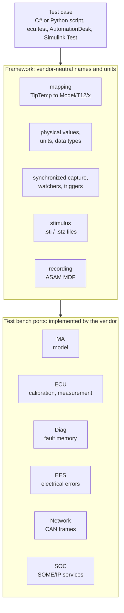
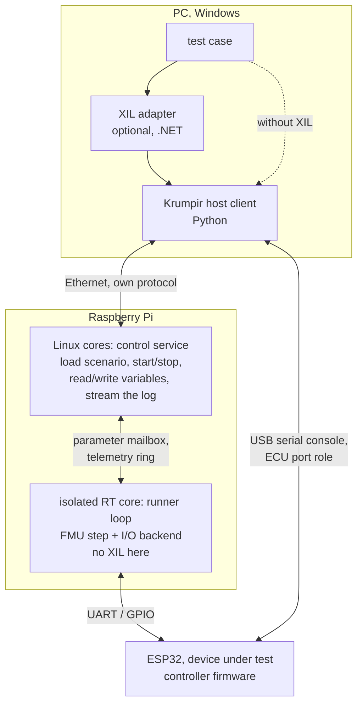

# XiL and the ASAM XIL standard

What "XiL" means, what the ASAM XIL standard defines, how Krumpir lines up with it, and the options
for using it.

## 1. Two meanings of "XiL"

**The method.** X-in-the-Loop is the ladder of test setups a controller climbs. At each rung, more
of the controller and the plant becomes real:

| Level | Controller | Plant | Link |
|---|---|---|---|
| MiL, model in the loop | a model (Simulink, Modelica, Python) | a model | one simulation |
| SiL, software in the loop | the production C, compiled for the PC | a model | function calls |
| PiL, processor in the loop | the production C on the target CPU | a model | debugger, serial or in the same chip |
| HiL, hardware in the loop | the real board with its real I/O | a real-time model on a separate machine | electrical signals or a bus |
| real plant | the real board | the real tip or motor | wires |

**The standard.** ASAM XIL ("Generic Simulator Interface") is an API standard between test
automation tools and test benches. A test case written against it should run unchanged on any XIL
bench: MiL, SiL or HiL, and from any vendor. The ASAM page puts it as "an API standard enabling
communication between test automation tools and test benches".

ASAM XIL does not define how the real-time loop runs, how a model is packaged or how the bench
talks to the device under test. Those are FMI, the bench vendor's real-time system, and buses or
XCP. XIL sits one layer above them: it is the remote control a test script uses to drive the bench.

## 2. ASAM XIL in short

### History

| Version | Date | Note |
|---|---|---|
| ASAM HIL 1.0.0 to 1.0.2 | 2009 to 2012 | the predecessor, HIL only |
| XIL 2.0.0 | Nov 2013 | renamed XIL, added the framework layer, MiL/SiL/HiL |
| XIL 2.0.1 / 2.0.2 | 2014 / 2015 | fixes |
| XIL 2.1.0 | Jun 2017 | the network port |
| XIL 2.2.0 | Mar 2020 | C# technology reference updated Dec 2021 |
| **XIL 3.0.0** | **30 Sep 2024** | current; **not backward compatible** with 2.x |

### Architecture

| Port | What a test can do through it |
|---|---|
| Model access (MA) | read model metadata, read and write model variables, capture, run scripts, step the simulation; 3.0 adds event-triggered updates |
| ECU access | read and write ECU variables, online/offline calibration, memory pages, synchronized recording, write calibration files such as ASAM CDF; new as one port in 3.0 |
| Diagnostic (Diag) | fault memory, variant coding, raw diagnostic services, diagnostic jobs |
| Electrical error simulation (EES) | define and switch electrical faults (open, short to ground or supply, pin to pin), triggered |
| Network | read and write CAN frames, replay captured bus traffic |
| Service-oriented (SOC) | new in 3.0: service tests, event subscription, capture to MDF |

### Technology and access

- The specification is a UML model with technology references for **C#** (with examples and a test
  suite) and **Python**. Vendors ship .NET assemblies; Python usually reaches them through
  `pythonnet` (dSPACE documents this route).
- The specification download is free for **ASAM members only**; the release slides and the table of
  contents are public. A C# source library for implementers is royalty-free.
- There is no open-source implementation of a full XIL bench that we found.
- Implementers and users are the HiL vendors and OEMs: dSPACE, Vector, ETAS, NI, MicroNova, AVL,
  HORIBA, tracetronic (ecu.test), MathWorks (Simulink Real-Time and Simulink Test support package),
  Bosch, BMW, Audi, Daimler and others.
- A separate, smaller **ASAM XIL-MA** (2.1.0, 2017) covers only model access, as a companion to FMI.

### Neighbouring standards

| Standard | Owner | What it does | Licence | Use for Krumpir |
|---|---|---|---|---|
| **FMI 3.0** | Modelica Association | packages a model as an FMU with a C API | free, open | already used by the runner |
| **SSP** | Modelica Association | describes a system of several FMUs, their wiring and parameter sets | free, open | later, when more than one FMU runs |
| **DCP** | Modelica Association | real-time co-simulation protocol (state machine and data units over UDP, TCP, CAN); real-time and non-real-time modes; 1.0 in 2019 | free, open | a standard alternative to our own frame protocol |
| **ASAM MDF 4** | ASAM | binary measurement file with channels, units and time bases | spec for members; open readers such as `asammdf` exist | a log format the industry tools open directly |
| **ASAM XCP** (MCD-1) | ASAM | measure and calibrate variables on an ECU over CAN, Ethernet, USB or serial | spec for members; open slave implementations exist | a standard replacement for the text console |
| **SIL Kit** | Vector and Synopsys | open-source library that connects SiL participants (virtual buses, FMU importer) | MIT | only for pure SiL with buses; not our real-time path |

## 3. How Krumpir lines up

### On the XiL ladder

| Level | In Krumpir today | Where |
|---|---|---|
| MiL | not used; we went straight to C. The numpy plant in `gen_golden.py` checks the plant model, not a controller | `libs/plants/t12/tools/` |
| SiL | yes: the controller code against the C plant on the PC, plus the plant FMU in the runner with `io = null` | `tools/scenarios.c`, `pio test -e native`, `runner/` |
| PiL | yes: the controller runs on the ESP32 against the plant model compiled into the same firmware | both controllers' firmware |
| HiL | designed, not built: the Pi runs the plant FMU at 1 kHz and talks to the ESP32 | `docs/architecture.md`, `runner/` |
| real plant | schematic only | `controllers/*/hardware/` |

One part of the design is unusual: the same C plant file feeds SiL, PiL and later the FMU. That is
what the XiL method asks for (one model at every level), and many commercial setups do not get it.

### Against the ASAM XIL concepts

| ASAM XIL concept | Krumpir equivalent | Gap |
|---|---|---|
| test bench | the runner (Pi) plus the DUT board | none in idea |
| test automation tool | `timing_check.py`, `capture.py`, CI workflows, the test sequence in `krumpir-interface.md` | no common API; each script talks serial directly |
| MA port: read/write model variables | `[model] params` and `[io] inputs/outputs` in `scenario.toml`, set before the run | no access while running (the parameter mailbox is designed, not built) and no remote access |
| MA port: simulation control | `krumpir run`, Ctrl-C, exit codes | no start/stop/step over a link |
| framework mapping and units | `[io]` names map straight to FMU variables; `capture.py` turns `_permille` and `_ma` into fractions and amps | no mapping layer and no unit metadata; units live in column suffixes |
| stimulus from signal descriptions | `stimulus` kinds `constant`, `step`, `sine` in TOML | no ramps, tables or replay of recorded signals |
| capture, triggers, watchers | every step goes to a CSV row | no triggers (for example "start capture when the trip fires") and no watchers |
| MDF recording | CSV | not readable by MDF tools, no channel units |
| ECU port: measurement and calibration | the ESP32 text console: `sp`, `kp`, `status`, `log on` | text, slow (115200 baud, 10 Hz rows), ad hoc per controller |
| Diag port: fault memory | `status` shows the latched trip, `clear` clears it | one trip only, no history |
| EES port: electrical faults | `fault open/short/stuck` inside the simulated tip | only simulated in the firmware; on a real HiL this needs a fault switch board between the bench and the DUT |
| Network port | none | CAN is out of scope |
| SOC port | none | not relevant |

### Where each part would run

XIL is the test automation side, so the Pi runs none of it. Commercial benches work the same way:
the XIL implementation runs on the host PC and talks to the real-time target over the vendor's own
link. What the Pi needs is a control service on its non-real-time cores that the host can call
(the runner is a command-line program today). That service is needed with or without XIL.

Summary: Krumpir already has the layers XIL assumes (bench, model access, DUT access, fault
injection, recording). What it lacks is a single host-side API with stable names over them. Every
tool reimplements its own serial handling and column conventions.

## 4. Adopting ASAM XIL: pros and cons

| Pros | Cons |
|---|---|
| The industry vocabulary: ports, mapping, capture, stimulus, EES. Docs and code read like any other HiL | The specification is for ASAM members only; membership costs money and suits companies, not a hobby bench |
| A test written to XIL could, in principle, also run on a dSPACE or Vector bench | Writing a compliant implementation is large: six ports, the framework, a UML-derived object model, and a cross-test to prove it |
| A clean split: test cases do not know about COM ports, UART frames or FMU variable references | To plug into existing XIL tools, the bench has to be delivered as .NET assemblies (the standard's interfaces and its C# framework library are .NET); that facade would run on the PC and talk to the Pi over the network, so the Pi itself needs no .NET |
| MDF recording would open the logs in CANape, asammdf, MATLAB and other tools directly | 3.0 broke compatibility with 2.x, so tools and examples are split between versions |
| Skills that carry over to HiL jobs in automotive | It does not help the hard part of Krumpir, the 1 ms real-time loop; that stays our own C |
| | Most of it (ECU calibration, diagnostics, SOME/IP, CAN) has no use for a T12 or a DC motor |

## 5. Options

### A. Ignore it

Keep the current tools. **Cost:** none. **Downside:** every new controller adds another set of
serial scripts and column names; nothing carries over to standard tooling.

### B. Borrow the structure, not the spec (recommended)

Use the XIL ideas without the members-only spec:

1. **One host-side Python package** (for example `tools/krumpir/`) with port-like objects that the
   existing scripts use instead of raw serial:
   - `Bench` (model access): load a scenario, start, stop, read and write model variables, capture.
   - `Dut` (ECU access): `set("sp", 350)`, `get_status()`, `stream()`; one class, with a small
     per-controller description of commands and telemetry columns.
   - `Faults` (EES): inject and clear faults, first in the simulated plant, later on a fault board.
2. **Mapping with units in one place**: a table per controller that maps a neutral name
   (`tip_temp`) to the source (`temp_c` column, `°C`) and replaces the suffix rules in `capture.py`.
3. **Richer stimulus**: add `ramp` and `table` (a CSV of time and value) to the scenario file; a
   table replays any recorded signal.
4. **Triggers on capture**: start or stop a capture on a condition, such as a trip or a threshold.

**Cost:** a few hundred lines of Python, mostly moved from `capture.py` and `timing_check.py`.
**Gain:** test scripts read like XIL tests, and a real XIL facade can wrap these classes later if it
is ever needed.

### C. Use the free neighbouring standards where they pay off

| Step | When it pays off |
|---|---|
| Keep FMI 3.0 | already done |
| MDF 4 output next to the CSV (through `asammdf` on the host, not in the real-time writer) | when logs go to someone with CANape or similar, or runs get long |
| XCP on the ESP32 instead of the text console | when the DUT needs fast measurement (1 kHz signals) or calibration from a standard tool; it replaces the ad hoc console, but costs flash and an XCP master on the host |
| SSP | when one run wires several FMUs together |
| DCP for the Pi to DUT link | if the link should be a standard. It is heavier than a 12-byte frame and needs a DCP slave on the ESP32; our own frame is simpler at 1 kHz over a UART |

### D. Implement a real XIL subset

A model access port (XIL-MA or the 3.0 MA port) as a C# or Python facade over the runner, tested
against vendor examples. **Needs:** ASAM membership or a company that has it, and a user who runs
XIL test tools against the bench. **Worth it** only when that user exists, for example if Krumpir
becomes a low-cost bench for a team that already writes XIL tests.

### E. Use a commercial XIL stack

Run the tests from a vendor tool and let Krumpir be one target among others. Not realistic for this
project; listed for completeness.

## 6. Recommendation

1. **Now:** option B. It fits the plan to add more controllers: the per-controller code shrinks to a
   description table, and the scripts become shared tests.
2. **With the HiL link:** keep the own frame protocol, but name its fields after the mapping table in
   B, so the link and the host API use the same names.
3. **Later and only on demand:** MDF output, XCP on the DUT, a fault switch board for EES on the real
   board, SSP for several FMUs.
4. **Not planned:** an ASAM XIL implementation (option D) until someone needs XIL tests to run
   against Krumpir.

## Sources

- ASAM XIL standard page, versions, ports and 3.0.0 notes: https://www.asam.net/standards/detail/xil/
  and https://www.asam.net/standards/detail/xil/older/
- ASAM XIL-MA: https://www.asam.net/standards/detail/xil-ma/
- ASAM XIL 2.2 release presentation (dSPACE):
  https://www.asam.net/index.php?eID=dumpFile&f=3487&t=f&token=5a1adf3b6ee0c2b01462d3311b5fddc5e425ca2e
- Open-source C# library for XIL (ASAM press release):
  https://www.pressebox.com/pressrelease/asam-e-v/ASAM-Expands-its-Business-Activities-towards-Professionally-Developed-Open-Source-Software-with-ASAM-XIL-20/boxid/677626
- dSPACE XIL API and Python through pythonnet: https://www.dspace.com/en/inc/home/applicationfields/portfolio/xil_api.cfm
- MathWorks, XIL API in Simulink Real-Time: https://www.mathworks.com/help/slrealtime/ug/classes-and-methods-of-asam-xil-api.html
  and the Simulink Test support package: https://uk.mathworks.com/matlabcentral/fileexchange/110320-simulink-test-support-package-for-asam-xil-standard
- DCP: https://fmi-tutorial.vti.se/FMI%20Tutorial/Introduction/Distributed%20Co-Simulation%20Protocol
  and the ACOSAR story: https://itea4.org/project/success-story/acosar-success-story.html
- SIL Kit: https://www.vector.com/silkit/ and https://vectorgrp.github.io/sil-kit-docs

Not checked against the specification text (members only): the exact class names of the 3.0 API,
the Python technology reference, and the `.sti` stimulus format.
